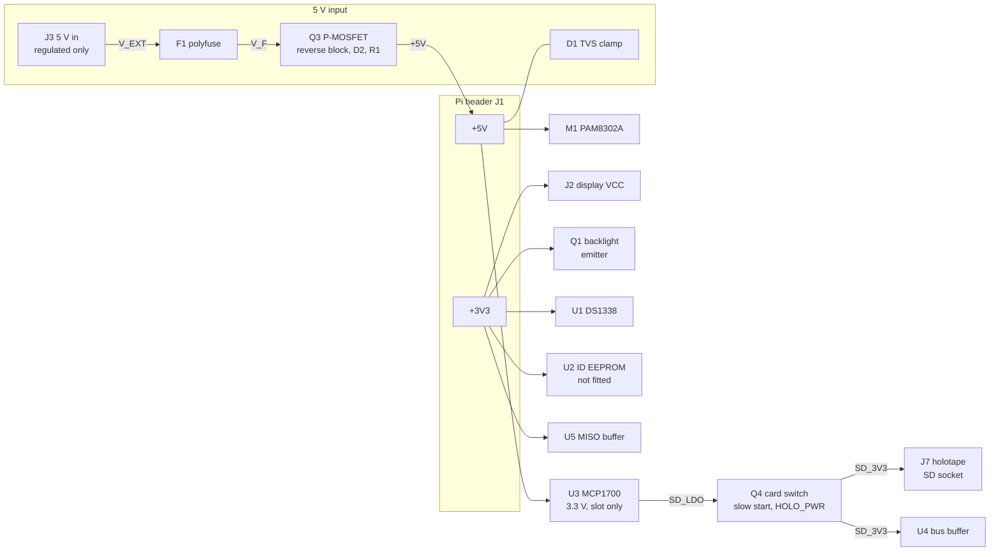
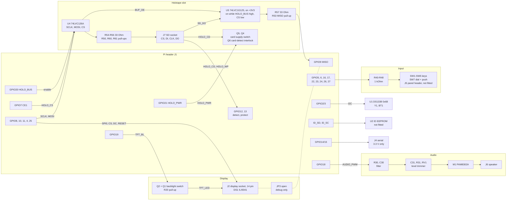

# Pip-Boy HAT

## 1. Status and scope

> **This is a proposal.** Nobody has built, measured or tested this board. Every electrical value below is a recommendation. Check each one against the current data sheet of the exact part you buy before you order boards.

The board turns a Raspberry Pi Zero, Zero W or Zero 2 W into a wrist device. It runs Pip-OS and its user interface, Deitrix. It carries an SPI colour display, six keys, a rotary dial with a push button, a small speaker amplifier, a clock chip, a serial console header and a holotape slot for SD cards.

It is for the owner of the project and for any hobbyist who solders one. It assumes you can read a schematic and solder SOIC and SOT-23 parts with an iron.

Confidence marks used for data sheet figures, as in the terminal controller spec:

| Mark | Meaning |
|---|---|
| known | A stable, widely published figure. Still check it. |
| typical, check | A figure from memory of the usual data sheet or module listing. Confirm it before use. |
| assumed | A design assumption, not a data sheet figure. |

"From memory, to verify" marks a part number or rating recalled without a data sheet at hand.

Software references:

- "BOARD_SUPPORT.md" is `docs/spec/BOARD_SUPPORT.md` in RobCo-Core. "display.md", "input.md", "audio.md" and "buses.md" are the files of that name in `docs/guide/api/` in RobCo-Core.
- "Pip-OS `HARDWARE.md`" and "Pip-OS `CONFIG.md`" are in `docs/` of Pip-OS. The `[display]` keys of `PIPOS.CFG` come from a Pip-OS branch not yet merged: `backend`, `tft_cs`, `tft_dc`, `tft_reset`, `tft_backlight`, `tft_hz`, `tft_rotation`, `tft_bgr`, `tft_invert`.
- "Deitrix" is the Deitrix `README.md`, which lists the keys the interface uses.

## 2. What the board does

- An ILI9341 display module, 2.8 inch, 240 by 320 pixels, plugs into a 14-pin socket. It sits on SPI0 with the pins of `TFT_CONFIG_DEFAULT`: CE0, D/C on GPIO 25, reset on GPIO 4. Its SDO pin stays off MISO, behind an open solder jumper.
- A holotape slot: a full-size SD socket on SPI0 CE1, GPIO 7, with card detect on GPIO 12 and write protect on GPIO 13. A bus buffer keeps the card off the bus, and a switched regulator keeps it unpowered, until the software turns them on with GPIO 20 and 21. See [section 4.12](#412-holotape-slot).
- A transistor pair switches the backlight from GPIO 19. A pull-up keeps it on when the software leaves the pin alone.
- Six 12 mm keys and a rotary encoder with a push button sit on the board, on the pins of the input example. A parallel 11-pin header, not fitted, takes a remote front panel instead.
- A DS1338 clock with a crystal and a CR1220 cell sits on I2C1 at `0x68`.
- A PAM8302A class-D module plays the PWM audio of GPIO 18 through a low-pass filter and a level trimmer.
- 5 V comes from the Pi's USB power port or from a 2-pin input header with a polyfuse, a reverse-polarity MOSFET and a TVS diode. The header takes a regulated 5 V source only.
- A 6-pin header carries the PL011 serial console at 3.3 V.
- An optional HAT ID EEPROM footprint is left unpopulated.

## 3. The 40-pin header map

Sources: BOARD_SUPPORT.md, section "Pins", with its audio table, the input example table and the "SPI display" table. `tools/check_pins.py` compares `pins.yaml` with all four.

<!-- pin-table:start -->
<!-- Generated by tools/gen_pin_table.py from pins.yaml. Edit pins.yaml, not this table. -->

| Pin | Pi function | Net | Software use (source) | This board connects | Status |
|---|---|---|---|---|---|
| 1 | 3V3 | `+3V3` | Power | 3V3 rail: display VCC, backlight switch Q1, U1, pull-ups, TP1. Not the card. | used |
| 2 | 5V | `+5V` | Power | 5V rail: Q3 source, fed from J3 through F1; D1, D2, M1, U3, TP2 | used |
| 3 | GPIO 2, SDA1 | `I2C_SDA` | I2C SDA (BOARD_SUPPORT.md Pins) | I2C SDA to U1, TP4 | used |
| 4 | 5V | `+5V` | Power | Joined to pin 2 | used |
| 5 | GPIO 3, SCL1 | `I2C_SCL` | I2C SCL (BOARD_SUPPORT.md Pins) | I2C SCL to U1, TP5 | used |
| 6 | GND | `GND` | Ground | GND | used |
| 7 | GPIO 4 | `TFT_RESET` | TFT RESET (BOARD_SUPPORT.md SPI display, TFT_CONFIG_DEFAULT) | J2 pin 4, RESET | used |
| 8 | GPIO 14, TXD | `UART_TX` | PL011 TXD (BOARD_SUPPORT.md UART policy and Pins) | J4 pin 5 | used |
| 9 | GND | `GND` | Ground | GND | used |
| 10 | GPIO 15, RXD | `UART_RX` | PL011 RXD (BOARD_SUPPORT.md UART policy and Pins) | J4 pin 4 | used |
| 11 | GPIO 17 | `BTN_LEFT` | LEFT (BOARD_SUPPORT.md Pins, input example) | SW3 and J5 pin 4 through R42, 1 kOhm | used |
| 12 | GPIO 18 | `AUDIO_PWM` | Audio channel 1 (BOARD_SUPPORT.md Pins, audio table: Pi Zero at ALT5) | Audio filter R30, C30 | used |
| 13 | GPIO 27 | `BTN_BACK` | BACK (BOARD_SUPPORT.md Pins, input example) | SW6 and J5 pin 7 through R45, 1 kOhm | used |
| 14 | GND | `GND` | Ground | GND | used |
| 15 | GPIO 22 | `BTN_RIGHT` | RIGHT (BOARD_SUPPORT.md Pins, input example) | SW4 and J5 pin 5 through R43, 1 kOhm | used |
| 16 | GPIO 23 | `DIAL_A` | Dial A (BOARD_SUPPORT.md Pins, input example) | SW7 A and J5 pin 8 through R46, 1 kOhm, C47 | used |
| 17 | 3V3 | `+3V3` | Power | Joined to pin 1 | used |
| 18 | GPIO 24 | `DIAL_B` | Dial B (BOARD_SUPPORT.md Pins, input example) | SW7 B and J5 pin 9 through R47, 1 kOhm, C48 | used |
| 19 | GPIO 10, MOSI | `SPI_MOSI` | SPI0 MOSI (BOARD_SUPPORT.md Pins) | J2 pin 6, SDI; holotape buffer U4 pin 5, 2A | used |
| 20 | GND | `GND` | Ground | GND | used |
| 21 | GPIO 9, MISO | `SPI_MISO` | SPI0 MISO (BOARD_SUPPORT.md Pins) | Holotape buffer U5 output through R57, 33 Ohm; R53 pull-up, 4.7 kOhm. J2 SDO only through JP3, open | used |
| 22 | GPIO 25 | `TFT_DC` | TFT D/C (BOARD_SUPPORT.md SPI display, TFT_CONFIG_DEFAULT) | J2 pin 5, D/C | used |
| 23 | GPIO 11, SCLK | `SPI_SCLK` | SPI0 SCLK (BOARD_SUPPORT.md Pins) | J2 pin 7, SCK, through R24, 33 Ohm; holotape buffer U4 pin 2, 1A | used |
| 24 | GPIO 8, CE0 | `TFT_CS` | SPI0 CE0 (BOARD_SUPPORT.md Pins) | J2 pin 3, CS | used |
| 25 | GND | `GND` | Ground | GND | used |
| 26 | GPIO 7, CE1 | `HOLO_CS` | SPI0 CE1 (BOARD_SUPPORT.md Pins) | Holotape buffer U4 pin 9, 3A; to J7 pin 1, CS, only through U4 and R56 | used |
| 27 | ID_SD, GPIO 0 | `ID_SD` | ID EEPROM (BOARD_SUPPORT.md Pins; avoided by the input example) | U2 SDA footprint, not fitted | optional |
| 28 | ID_SC, GPIO 1 | `ID_SC` | ID EEPROM (BOARD_SUPPORT.md Pins; avoided by the input example) | U2 SCL footprint, not fitted | optional |
| 29 | GPIO 5 | `BTN_UP` | UP (BOARD_SUPPORT.md Pins, input example) | SW1 and J5 pin 2 through R40, 1 kOhm | used |
| 30 | GND | `GND` | Ground | GND | used |
| 31 | GPIO 6 | `BTN_DOWN` | DOWN (BOARD_SUPPORT.md Pins, input example) | SW2 and J5 pin 3 through R41, 1 kOhm | used |
| 32 | GPIO 12 | `HOLO_CD` | holotape card detect (this board; avoided by the input example, BOARD_SUPPORT.md Pins) | Holotape slot J7 CP, R58 pull-up. Input only, never PWM | used |
| 33 | GPIO 13 | `HOLO_WP` | holotape write protect (this board; avoided by the input example, BOARD_SUPPORT.md Pins) | Holotape slot J7 WP, R59 pull-up. Input only, never PWM | used |
| 34 | GND | `GND` | Ground | GND | used |
| 35 | GPIO 19 | `TFT_BL` | TFT backlight (this board; not a default: PIPOS.CFG tft_backlight = 19) | R20 pull-up and R21 to the Q2 base, backlight switch | used |
| 36 | GPIO 16 | `DIAL_PUSH` | Dial push (BOARD_SUPPORT.md Pins, input example) | SW7 push and J5 pin 10 through R48, 1 kOhm | used |
| 37 | GPIO 26 | `BTN_SELECT` | SELECT (BOARD_SUPPORT.md Pins, input example) | SW5 and J5 pin 6 through R44, 1 kOhm | used |
| 38 | GPIO 20 | `HOLO_BUS` | holotape bus enable (this board; avoided by the input example, BOARD_SUPPORT.md Pins) | Holotape buffer U4 enables 1OE, 2OE, 3OE; R63 pull-down | used |
| 39 | GND | `GND` | Ground | GND | used |
| 40 | GPIO 21 | `HOLO_PWR` | holotape power (this board; avoided by the input example, BOARD_SUPPORT.md Pins) | Holotape supply switch: R65 to the Q5 base; R64 pull-down | used |

<!-- pin-table:end -->

Notes on the map:

- Every pin that the software tables name has its software use. No default moves. An unedited `PIPOS.CFG` drives the display, the keys, the dial, the audio and the clock.
- GPIO 19 is the only pin this board adds. It switches the backlight. Pip-OS takes `tft_backlight = none` by default, so the line `tft_backlight = 19` must go into `PIPOS.CFG` before `power` off can darken the screen. Without it the pull-up R20 keeps the backlight on. See [section 4.2](#42-backlight).
- GPIO 19 is free in every software table, and the Pip-OS display code accepts it: it refuses panel pins that collide with the keys, the dial, audio on GPIO 18, 40, 41 and 45, I2C, SPI0 and the PL011.
- GPIO 7, CE1, selects the holotape card. GPIO 12 reads its card detect switch and GPIO 13 its write protect switch. GPIO 20, `HOLO_BUS`, enables the slot's bus buffer. GPIO 21, `HOLO_PWR`, switches the card's supply. No software table names these uses yet. See [section 4.12](#412-holotape-slot).
- GPIO 12 and 13 at ALT0 can carry stereo PWM on the Zero (audio.md, section `audio.h`). The slot takes that option away. Mono PWM on GPIO 18 stays.
- After the holotape slot the board has no free GPIO. GPIO 20 and 21 were the last two.
- GPIO 12 and 13 must stay inputs. The software must never set them to their PWM function: the switches would short a driven pin to `GND`.
- MISO, GPIO 9, reaches only the holotape buffer U5. The display's SDO sits behind JP3, open.
- The module also carries an SD slot and touch pins. This board connects neither. See [section 4.1](#41-display).

## 4. Circuit blocks

Net names follow plan section 5 and the terminal controller: rails `+3V3`, `+5V`, `GND` and `V_EXT`; buses `I2C_SDA`, `I2C_SCL`, `SPI_SCLK`, `SPI_MOSI`, `SPI_MISO`; display lines `TFT_CS`, `TFT_DC`, `TFT_RESET`, `TFT_BL`, `TFT_LED`; inputs `BTN_UP`, `BTN_DOWN`, `BTN_LEFT`, `BTN_RIGHT`, `BTN_SELECT`, `BTN_BACK`, `DIAL_A`, `DIAL_B`, `DIAL_PUSH`; `AUDIO_PWM`, `UART_TX`, `UART_RX`, `ID_SD`, `ID_SC`. The full list is in [section 5](#5-net-names).

Every resistor is 1/4 W metal film, 1 %, through-hole, unless the row says otherwise. Every 100 nF capacitor is ceramic X7R, 50 V, 2.54 mm or 5.08 mm lead pitch. The only SMD parts are U1 and U2 in SOIC-8, U4 in SOIC-14, Q3 and Q4 in SOT-23, U5 in SOT-23-5, D3 in SOT-23-6, not fitted, and the SD socket J7. U2 is not fitted. SOT-23 has three leads at 0.95 mm pitch, and an iron with a fine tip solders it. J7's contacts sit on a 2.5 mm pitch with large pads (typical, check).

### 4.1 Display

Choice: a common 2.8 inch ILI9341 module, 240 by 320 pixels, SPI, on a single-row 14-pin header. The usual red module of this class is sold as MSP2807 or under the TJCTM24028-SPI name (from memory, to verify).

Why:

- The software drives an ILI9341 over SPI and assumes "the glass is mounted the way common 2.4" and 2.8" modules mount it" (display.md, section `tft.h`). These modules match that.
- The module brings its own backlight resistor and a 2.54 mm header. Nothing on it needs an iron finer than a pin header.
- 2.8 inch gives about 57.6 by 43.2 mm of active area (typical, check). At 320 by 240 that is 0.18 mm per pixel, readable on a wrist.

Rejected:

- A 2.4 inch module of the same family: smaller and lighter, about 0.15 mm per pixel. The same footprint fits it if its header has the same order. The owner can take it if the case asks for it.
- A bare panel on an FPC: thinner, but it needs a fine-pitch FPC connector, a backlight driver and a panel-specific footprint. None of that is hand-solderable.
- An ILI9341 module with a parallel bus: the software has no parallel driver.

Module header, the order this footprint follows (typical, check against the module you buy, because sellers differ):

| J2 pin | Module pin | Net | Pi pin |
|---|---|---|---|
| 1 | VCC | `+3V3` | |
| 2 | GND | `GND` | |
| 3 | CS | `TFT_CS` | GPIO 8, CE0, header pin 24 |
| 4 | RESET | `TFT_RESET` | GPIO 4, header pin 7 |
| 5 | DC/RS | `TFT_DC` | GPIO 25, header pin 22 |
| 6 | SDI (MOSI) | `SPI_MOSI` | GPIO 10, header pin 19 |
| 7 | SCK | `SPI_SCK_J` | GPIO 11, header pin 23, through R24 |
| 8 | LED | `TFT_LED` | Q1 collector |
| 9 | SDO (MISO) | `TFT_SDO` | JP3, open. Not on GPIO 9. |
| 10 | T_CLK | not connected | |
| 11 | T_CS | not connected | |
| 12 | T_DIN | not connected | |
| 13 | T_DO | not connected | |
| 14 | T_IRQ | not connected | |

Silkscreen the module pin names beside J2. If the bought module has another order, do not plug it in: the schematic step must change J2.

| Ref | Part | Connection |
|---|---|---|
| J2 | 1x14 female header, 2.54 mm, 8.5 mm tall | As above |
| DS1 | ILI9341 2.8 inch SPI module | Plugs into J2. Bought, not soldered to the board. |
| R24 | 33 Ohm | `SPI_SCLK` to `SPI_SCK_J`, near J1 |
| JP3 | 2-pad solder jumper, open | `SPI_MISO` to `TFT_SDO` when closed. Debug only, with `HOLO_BUS` low. |
| C1 | 10 uF, 10 V ceramic, radial | `+3V3` to `GND` at J2 pin 1 |
| C2 | 100 nF | `+3V3` to `GND` at J2 pin 1 |
| H1 to H4 | M3 holes for the module's corner holes | Positions from the module bought |

Logic and supply: the module runs on 3.3 V, with 3.3 V logic. The Pi's pins are not 5 V tolerant (known), so VCC is `+3V3` and no level shifter is needed. Many of these modules carry a small 3.3 V regulator on VCC and a jumper pad, often marked J1, that bypasses it for a 3.3 V supply (typical, check the module). Close that pad if the module asks for it at 3.3 V.

SPI rate: the software asks for 10 MHz, the fastest write clock in the ILI9341 data sheet, and gets 9.62 MHz (BOARD_SUPPORT.md, section "SPI display"). R24 damps ringing on the clock line. With about 20 pF of trace and input (assumed), 33 Ohm x 20 pF = 0.66 ns, nothing against a 104 ns period. Keep the SPI traces under 50 mm.

MISO: not wired to the panel. The holotape card shares SPI0, and its buffer U5 owns MISO. The panel driver never needs to read the panel to draw. `tft_read_id()` reads the panel id at 4 MHz and returns `TFT_ERR_NO_PANEL` when MISO reads all zeros or all ones (display.md, section "Power and id"). On this board it returns that error unless JP3 is closed. JP3 is a solder jumper, open by default. Nobody fits it by mistake from a BOM. Close it only to debug the panel, then open it again. Keep `HOLO_BUS` low while JP3 is closed: U5 then stays off, and only the panel's SDO drives MISO.

Touch and SD: the module's touch pins T_CLK to T_IRQ reach J2 pins 10 to 14 and stay open. The software has no touch driver, and a wrist device has keys. The SD slot has its own 4-pin header on the module (typical, check). This board fits nothing there. The Pi's own card holds the system. The holotape slot now takes CE1, GPIO 7. A touch controller would need a third chip select on a free GPIO.

Mounting: the module sits over the board on J2 and four M3 standoffs. With an 8.5 mm female header and the module's pins seated, the module board sits about 11 mm above this board (assumed, check the header bought). Use 11 mm M3 standoffs, or the height the header gives. Parts under the module must stay below 6 mm. The SD slot on the module's back is about 2.5 mm tall (typical, check). Keep J2's row clear of it.

Height of the stack, from the bottom of the Pi to the top of the glass, all assumed until a sample is measured:

| Layer | Height |
|---|---|
| Pi Zero, parts on the bottom and the board | 1.0 mm + 1.4 mm |
| Pi header to this board: male header on the Pi in an 8.5 mm female header | 11 mm |
| This board | 1.6 mm |
| This board to the module board | 11 mm |
| Module board and glass | 1.6 mm + 4 mm |
| Total | about 31 mm |

A low-profile header pair or a Pi soldered straight to the board would save about 8 mm. That is an owner choice with the case.

Rotation: the software default is 90, landscape, 320 by 240. If the picture comes out upside down with the module mounted, set `tft_rotation = 270`. If colours swap red and blue, flip `tft_bgr`. Bring-up step 15 checks both.

### 4.2 Backlight

Choice: a GPIO switches the backlight through two transistors, and a pull-up keeps it on by default.

Why: Pip-OS can then darken the screen when it turns the display off. The driver keeps the backlight pin high only while the display is on and the panel is awake (display.md, section "Power and id"). The backlight is the largest load on `+3V3`, so a dark screen saves most of the display current.

Rejected:

- Always on from `+3V3` through the module's own resistor: simplest, but `power` off leaves the screen lit and draws the full current.
- A GPIO straight to the LED pin: the module draws far more than a GPIO can source. display.md warns about it.
- PWM dimming: the driver only switches the pin. GPIO 19 can carry PWM1 at ALT5 (typical, check: BCM2835 alternate functions), so a later driver could dim it with this circuit unchanged.

Pin: GPIO 19, header pin 35. It is not the default. `PIPOS.CFG` must say `tft_backlight = 19`.

| Ref | Part | Connection |
|---|---|---|
| Q1 | PNP, BC327-25, TO-92 | Emitter `+3V3`, collector `TFT_LED`, base `BL_PB` |
| R23 | 10 kOhm | Q1 base to emitter |
| R22 | 470 Ohm | `BL_PB` to Q2 collector |
| Q2 | NPN, 2N3904, TO-92 | Emitter `GND`, base `BL_NB` |
| R21 | 4.7 kOhm | `TFT_BL`, GPIO 19, to `BL_NB` |
| R20 | 4.7 kOhm | `TFT_BL` to `+3V3`, the default-on pull-up |
| TP7 | Test point | `TFT_LED` |

Operation: `TFT_BL` high turns Q2 on. Q2 pulls Q1's base down through R22. Q1 feeds `+3V3` to the module's LED pin. `TFT_BL` low turns both off, and R23 holds Q1 off.

Backlight current: the module's LED pin feeds four white LEDs in parallel through a resistor on the module (typical, check). Design on 100 mA (assumed). With about 3.1 V at the LED pin, the current depends strongly on the LEDs' forward voltage, about 2.9 V to 3.2 V for white LEDs (typical, check). It may be well under 100 mA and the screen dim. Some modules instead drive an on-module transistor from the LED pin. Then the pin draws a few mA and the module lights the LEDs from VCC. Bring-up step 6 measures the current and shows which case applies. A later revision could feed the LED pin from `+5V` through a series resistor, sized from that measurement.

Q1 drive. Q2 saturated pulls `BL_PB` to 0.1 V (assumed). Q1's base-emitter drop is about 0.8 V at 100 mA (typical, check). R22 carries (3.3 - 0.8 - 0.1) / 470 = 5.1 mA. R23 takes 0.8 V / 10 kOhm = 0.08 mA. Q1 gets 5.0 mA of base current, a forced gain of 100 / 5 = 20. A BC327-25 has a gain of 160 or more at 100 mA (from memory, to verify), so the margin is 8. Q1 then drops about 0.2 V (typical, check), and dissipates 0.2 V x 0.1 A = 20 mW. The module sees about 3.1 V. The backlight is a little dimmer than on a direct 3.3 V feed.

Q2 drive, GPIO driven high: (3.3 - 0.7) / 4.7 kOhm = 0.55 mA into the base. Q2 carries 5.1 mA, a forced gain of 9. A 2N3904 has a gain of 100 or more at 10 mA (from memory, to verify). The GPIO sources 0.55 mA.

Default with the pin left alone: GPIO 19 is an input with a pull-down at reset, about 50 kOhm (typical, check: BCM2835 pins 9 to 27). R20 against it gives 3.3 V x 50 / (50 + 4.7) = 3.02 V, with a source resistance of 4.7 kOhm in parallel with 50 kOhm = 4.3 kOhm. The base gets (3.02 - 0.7) / (4.3 + 4.7) kOhm = 0.26 mA, a margin of 0.26 x 100 / 5.1 = 5. With a pull-down as strong as 30 kOhm (assumed lowest) it still gets 0.25 mA. The backlight stays on.

GPIO driven low: the pin sinks 3.3 V / 4.7 kOhm = 0.7 mA through R20. Q2 is off.

Power-up: the backlight comes on as soon as `+3V3` rises, before the panel shows anything. With `tft_backlight = 19`, `tft_init()` drives the pin low, then high after the panel set-up (display.md, section `tft.h`). The screen flashes white for the time the firmware and Pip-OS take to start. That is accepted. A pull-down in place of R20 would keep it dark, but then an unedited configuration would never light the screen.

### 4.3 3.3 V budget

`+3V3` comes from the Pi's regulator. This board draws:

| Load | Current | Confidence |
|---|---|---|
| Backlight | 100 mA | assumed, measure in bring-up |
| Display logic | 10 mA | assumed |
| Q1 and Q2 base drive | 5 mA | from section 4.2 |
| R20 with GPIO 19 low | 0.7 mA | from section 4.2 |
| DS1338 | 0.2 mA | typical, check |
| I2C pull-ups on the Pi, when low | 1.8 mA each | known, BOARD_SUPPORT.md |
| Holotape pull-ups R53, R58, R59, when their lines are low | 1.4 mA | from section 4.12 |
| Holotape card and buffers | 0 mA: they run from U3 and Q4 on `+5V` | section 4.12 |
| Total | about 121 mA | |

Limit: budget 200 mA for a HAT on the Zero's `+3V3` (assumed, to verify). The Zero makes 3.3 V with a switching regulator (from memory, to verify), so 120 mA at 3.3 V costs about 3.3 V x 0.12 A / 0.85 / 5 V = 93 mA at 5 V, with 85 % efficiency (assumed). If the regulator turns out weaker, power the backlight from `+5V` through a resistor in a later revision.

The holotape card would add up to 100 mA here (to verify), 220 mA in all, above the 200 mA budget. That is why the slot has its own regulator on `+5V`.

### 4.4 Keys and dial

Choice: the keys and the dial sit on this board, and a parallel header carries the same lines to a remote front panel. The header is not fitted by default. Fit either the on-board switches or a panel, not both on one line, or a key press on one shows on the other.

Why: a wrist device needs its controls on the same face as the screen. Keys on the board need no cable. The header keeps the option of a case where the keys sit apart from the board.

Rejected:

- A header only: every build would need a hand-wired panel and a cable inside a moving wrist case.
- Switches only: a case that does not match the board's key positions would have no way out.

Keys the software needs: UP, DOWN, LEFT, RIGHT, SELECT, BACK, and the dial with its push (Deitrix; Pip-OS `HARDWARE.md`, section "Pins"). Deitrix uses the dial, LEFT and RIGHT to move between tabs and BACK to leave a nested view.

| Ref | Part | Net at the switch | Through | Pi pin |
|---|---|---|---|---|
| SW1 | 12 mm tactile switch | `BTN_UP_SW` | R40 | GPIO 5, header pin 29 |
| SW2 | 12 mm tactile switch | `BTN_DOWN_SW` | R41 | GPIO 6, header pin 31 |
| SW3 | 12 mm tactile switch | `BTN_LEFT_SW` | R42 | GPIO 17, header pin 11 |
| SW4 | 12 mm tactile switch | `BTN_RIGHT_SW` | R43 | GPIO 22, header pin 15 |
| SW5 | 12 mm tactile switch | `BTN_SELECT_SW` | R44 | GPIO 26, header pin 37 |
| SW6 | 12 mm tactile switch | `BTN_BACK_SW` | R45 | GPIO 27, header pin 13 |
| SW7 | Rotary encoder with push switch | A `DIAL_A_SW`, B `DIAL_B_SW`, C `GND`, push `DIAL_PUSH_SW` and `GND` | R46, R47, R48 | GPIO 23, 24, 16, header pins 16, 18, 36 |

Each switch ties its line to `GND` when pressed.

| Ref | Part | Connection |
|---|---|---|
| R40 to R48 | 1 kOhm | Series, Pi side net such as `BTN_UP` to switch side net such as `BTN_UP_SW`, in the order above |
| C40 to C45 | 100 nF, not fitted | `BTN_UP` to `BTN_BACK`, on the Pi side, to `GND` |
| C46 | 100 nF, not fitted | `DIAL_PUSH` to `GND` |
| C47, C48 | 10 nF, C0G or X7R | `DIAL_A` and `DIAL_B` to `GND` |
| J5 | 1x11 pin header, 2.54 mm, not fitted | 1 `GND`, 2 UP, 3 DOWN, 4 LEFT, 5 RIGHT, 6 SELECT, 7 BACK, 8 DIAL_A, 9 DIAL_B, 10 DIAL_PUSH, 11 `GND`, all on the switch side nets |

Parts, from memory, to verify:

- Keys: a 12 by 12 mm through-hole tactile switch with a round cap, such as the Omron B3F-4055 or a generic equivalent. The 6 by 6 mm switch fits too, but is hard to find through a case wall.
- Dial: Bourns PEC11R-4215F-S0024, 24 detents, 24 pulses per turn, push switch, 15 mm flatted shaft. Pip-OS counts 4 A/B transitions per detent (`PIPOS_DIAL_PER_DETENT`, Pip-OS `HARDWARE.md`). That needs one full quadrature cycle per detent, so the pulse count must equal the detent count. A 12-pulse, 24-detent part gives 2 transitions per detent: half a step per click with the default. Do not buy it.

Pull-ups: the Pi's internal ones. The input example and Pip-OS set `GPIO_PULL_UP` on each key, and `input_gpio_add_dial()` sets pull-ups on A, B and the push (input.md, section "GPIO buttons and dial"). The board adds none. The BCM2835 pull-up is about 50 kOhm (typical, check).

Series resistors: R40 to R48 limit current to 3.3 V / 1 kOhm = 3.3 mA if a cable fault on J5 puts a line on a rail, and they slow an ESD pulse from the header. A pressed key reads 3.3 V x 1 / (50 + 1) = 0.065 V, a clean low.

Debounce: the software samples every pin at 100 Hz and debounces keys over 20 ms (Pip-OS `HARDWARE.md`). The keys need no hardware filter. C40 to C46 are footprints for a noisy panel cable: with one fitted, the line rises through the 50 kOhm pull-up with a time constant of 50 kOhm x 100 nF = 5 ms, inside the 20 ms window.

Dial filter: C47 and C48 are fitted. The 10 nF with the pull-up slows only rising edges. A release recharges them through the pull-up: 50 kOhm x 10 nF = 0.5 ms. A press discharges them through 1 kOhm: 1 kOhm x 10 nF = 10 us, so falling edges stay fast. The filter masks bounce that opens the contact for less than about 0.4 ms: the line does not reach the input high level in that time. Longer bounce passes. The decoder tolerates bounce on one channel anyway: it moves one state forward and back.

Dial speed: the decoder samples every 10 ms, so each A or B state must last at least 10 ms. The four states of a real encoder are not equal in length (assumed, check the encoder's phase tolerance). The shortest one sets the limit. At 100 Hz sampling the safe limit is about 12 detents per second, half a turn per second of a 24-detent dial, not the 25 detents per second that equal states would give. A missed state shifts the detent phase until power-off, which is worse than a lost step: every later click may then count at the wrong point. The working limit is about 12 detents per second. The filter's 0.5 ms does not lower it. A faster dial needs a faster tick or an edge interrupt in the software, see the open items.

ESD: the keys sit behind plastic caps. J5 leads to a panel inside the same case. The 1 kOhm resistors and the Pi's pad clamps are the only protection. A TVS array was rejected to keep the part count low on keys behind plastic caps. A panel exposed to touch should add its own protection.

Layout for a wrist device, worn on the left forearm and used with the right hand. The keys and the dial sit on a strip to the right of the screen, nearest the hand:

| Item | Face | Position | Note |
| --- | --- | --- | --- |
| DS1 display | Top | Left part of the board | 2.8 inch, 320 x 240, landscape |
| J2 | Top | On the module's short edge, left | Display socket |
| Key strip | Top | Right of the screen | Nearest the hand |
| SW7 dial | Top | Key strip, top | |
| SW6 BACK | Top | Key strip, under the dial | |
| UP | Top | Key strip, top of the cross | |
| LEFT, SEL, RT | Top | Key strip, middle row of the cross, left to right | |
| DOWN | Top | Key strip, bottom of the cross | |

The picture of the layout is exported from the KiCad board file once the placement step has produced it.

UP, DOWN, LEFT and RIGHT form a cross with SELECT in its centre, on a 14 mm grid. The dial sits at the top of the strip, where a thumb turns it, and BACK sits between the dial and the cross.

### 4.5 Audio

How audio leaves a Zero (BOARD_SUPPORT.md, section "Pins"; audio.md, section "Wiring"): PWM channel 1 on GPIO 18 at ALT5, mono. The Zero has no jack, so this board filters the pin.

Choice: the same filter and the same PAM8302A module as the terminal controller, with a trimmer as a level ceiling and no jack input.

| Ref | Part | Connection |
|---|---|---|
| R30 | 270 Ohm | `AUDIO_PWM`, GPIO 18, header pin 12, to `AUD_F` |
| C30 | 33 nF film or C0G | `AUD_F` to `GND` |
| C31 | 10 uF, 16 V electrolytic or film | `AUD_F` to `AUD_DC`, DC block |
| R31 | 33 kOhm | `AUD_DC` to `AUD_T`, sets RV1's range |
| RV1 | 10 kOhm trimmer, through-hole | Ends `AUD_T` and `GND`, wiper `AUD_IN` |
| M1 | PAM8302A class-D mono amplifier module, 5 input pins on 2.54 mm and 2 output pads on the opposite edge | Vin `+5V`, GND `GND`, A+ `AUD_IN`, A- `GND`, SD not connected, outputs `SPK_P` and `SPK_N` |
| C32 | 100 nF | M1 Vin to `GND` |
| C33 | 47 uF, 16 V electrolytic | `+5V` to `GND`, near M1 |
| J6 | 1x2 pin header, 2.54 mm, or a 2-pin JST PH | `SPK_P`, `SPK_N`. Silkscreen "SPK 8 Ohm. Neither side is ground." |
| LS1 | Speaker, 8 Ohm, 0.5 W or more, 20 to 28 mm round | On J6, off the board |
| TP6 | Test point | `AUD_IN` |

Filter: the terminal controller arithmetic applies unchanged. f = 1 / (2 x pi x 270 x 33e-9) = 17.9 kHz, the values audio.md gives. Source level: the PWM swings 0 to 3.3 V. After C31 a full-scale signal is at most 1.65 V peak, either way of zero. A full-scale square wave is then 1.65 Vrms. A full-scale sine is 1.65 / 1.41 = 1.17 Vrms. Pip-OS tones are square waves: `audio_set_volume()` sets the duty cycle, and 100 gives 50 %, the loudest square wave (RobCo-Core `docs/guide/api/audio.md`). PCM samples are 8-bit, scaled by the volume around 128, so a full-scale sine is the loudest PCM case. The 1.1 Vrms of the terminal controller (BRINGUP.md, step 17) treated a square wave as a sine. This section uses the 1.65 V peak for clipping and power.

Where it differs from the terminal controller:

- No jack and no source jumper. Every supported Zero has its PWM on GPIO 18.
- R31 sits above RV1, so the working point falls between 30 % and 50 % of the travel. See "Trimmer range" below.
- RV1 is a ceiling, not a volume knob. Software volume exists: `[audio] volume` in `PIPOS.CFG`, 0 to 100, and Deitrix has a Volume row on its RADIO tab. RV1 sets the loudest level once, so volume 100 does not clip the amplifier or overload a small speaker or a power bank.
- A smaller speaker: 8 Ohm only, no 4 Ohm. 8 Ohm halves the peak current.

Why the PAM8302A module: the chip comes only in small packages that are hard to solder with an iron (typical, check: MSOP-8 or DFN). The module brings it ready-soldered, as on the first board. Rejected: the LM386 in DIP-8. It is hand-solderable, but class AB wastes more of a battery's energy and needs its own gain and output parts.

Power: set RV1 so a full-volume square wave gives at most 2 V peak on the speaker, 2 V x 2 V / 8 Ohm = 0.5 W. A square wave's rms equals its peak, so this is the worst case and the speaker rating of 0.5 W is checked against it. A full-scale PCM sine at the same setting also peaks at 2 V and gives 2 V x 2 V / 2 / 8 Ohm = 0.25 W. The amplifier then draws 0.5 W / 0.85 / 5 V = 118 mA from `+5V` (efficiency 85 %, typical, check). Budget 150 mA. Unlimited, a clipped square wave in bridge mode at 5 V could put 5 V x 5 V / 8 Ohm = 3.1 W into the speaker and draw 3.1 / 0.85 / 5 = 0.74 A. That is why RV1 stays. Idle current about 4 mA (typical, check). SD stays open: the module pulls it high (typical, check the module), and a pin to shut it down would save 20 mW at most.

M1's footprint `RobCo:PAM8302A_Module_In1x05_P2.54mm_Out1x02_P3.50mm` is drawn from memory of the common breakout, to verify against the module bought: a row of 5 input pins on 2.54 mm, pins 1 VIN, 2 GND, 3 SD, 4 A+, 5 A-, and the speaker terminal on the opposite edge, pins 6 OUT+ and 7 OUT- on 3.5 mm, 15.24 mm from the input row. Redraw it from the real module before any board is ordered. With pins soldered at both edges, OUT+ and OUT- reach J6 through the board. A builder may instead wire the speaker straight to the module's terminal.

The PAM8302A drives the speaker in bridge mode (typical, check). Neither speaker wire is ground.

Trimmer range: the module's gain is about 24 dB, 15.8 times (from memory, to verify). 2 V peak at the speaker needs 2 V / 15.8 = 0.127 V peak at A+, 0.077 of the 1.65 V source. RV1 alone, unloaded, would sit at 8 % of its travel, too close to the end to set well. R31 divides first.

The network: the source is the filtered PWM through R30, 270 Ohm, and C31. C31 is 16 Ohm at 1 kHz, and both are small next to R31, so this section ignores them. R31 feeds the top of RV1. The wiper splits RV1 at position x, 0 at `GND` and 1 at the top: (1 - x) x RV1 above the wiper, x x RV1 below it. The module's input impedance Zin sits in parallel with the lower part. With Rlow = (x x RV1) in parallel with Zin:

V(A+) / V(source) = Rlow / (R31 + (1 - x) x RV1 + Rlow)

Zin is about 10 kOhm (from memory, to verify) and could be well above it. This section takes 10 kOhm to 100 kOhm. Step 18 of BRINGUP.md measures it. R31 = 33 kOhm (E12) keeps the 2 V target between 30 % and 50 % of the travel across that range:

| Zin | RV1 position for 2 V peak | Speaker peak at full travel, square wave |
|---|---|---|
| 10 kOhm | 47 % | 3.4 V |
| 30 kOhm | 37 % | 4.8 V |
| 100 kOhm | 34 % | 5.6 V asked, clipped near 5 V |

R31 = 27 kOhm would put the 100 kOhm case at 29 %. R31 = 51 kOhm put the 10 kOhm case at 79 %, and its full travel gave only 2.3 V. At full travel with a high Zin the amplifier clips at its 5 V supply. That is acceptable for a ceiling set once at bring-up: the target sits well below the end, and step 18 stops at 2 V. Turned fully up by mistake, the speaker can see a clipped square wave near 5 V peak, about 3.1 W, as section "Power" says.

C31 into the network: the lowest resistance it sees is R31 plus RV1 in parallel with 10 kOhm, at full travel, about 38 kOhm. The corner is 1 / (2 x pi x 38 kOhm x 10 uF) = 0.42 Hz.

### 4.6 Clock

Same part and the same lessons as the terminal controller, section 4.2.

| Ref | Part | Connection |
|---|---|---|
| U1 | DS1338, 3.3 V grade, SOIC-8, example DS1338Z-33+ | Pins below |
| Y1 | 32.768 kHz crystal, 6 pF load, cylindrical through-hole | U1 pins 1 and 2. No load capacitors. |
| BT1 | CR1220 holder, through-hole | Plus to `VBAT`, minus to `GND` |
| C10 | 100 nF | U1 VCC to `GND` |
| JP1 | 2-pad solder jumper, open | `VBAT` to `GND` when closed. Close only with no cell in BT1. |
| R10, R11 | 4.7 kOhm, not fitted | `I2C_SDA` and `I2C_SCL` to `+3V3` |
| R15 | 10 kOhm, not fitted | `SQW` to `+3V3` |
| TP4, TP5, TP8 | Test points | `I2C_SDA`, `I2C_SCL`, `SQW` |

DS1338 SOIC-8 pins (typical, check; same as the DS1307): 1 X1, 2 X2, 3 VBAT, 4 GND, 5 SDA, 6 SCL, 7 SQW/OUT, 8 VCC. The own symbol `DS1338` in `lib/RobCo.kicad_sym` assumes this order.

VBAT must not float. The DS1307 family asks for VBAT grounded when no battery is used (typical, check: from memory, to verify for the DS1338). Fit the cell before the first power-up, or close JP1. A closed JP1 shorts a fitted cell: open it before you fit one.

Pull-ups: the Pi has fixed 1.8 kOhm pull-ups on GPIO 2 and 3 (BOARD_SUPPORT.md, section "Pins"). A low line sinks 3.3 V / 1.8 kOhm = 1.83 mA, inside the 3 mA standard-mode limit (known). R10 and R11 stay empty: in parallel they would raise it to 2.54 mA for no gain on a short bus.

Cell: a CR1220, not the CR2032 of the first board. Its holder is about 13 mm across against 20 mm or more, which matters on a wrist board. A CR1220 holds about 35 mAh (typical, check). The DS1338 draws under 1 uA from VBAT (typical, check). 35 mAh / 1 uA = 35000 h, about 4 years. That is enough.

The software reads a DS1307, DS1338 or DS3231 at `0x68` and reports the DS1338 as `chip=0` (buses.md, section `rtc.h`). Deitrix shows `--:--` when Pip-OS has no clock.

### 4.7 HAT ID EEPROM

Choice: an optional footprint, not fitted, as on the first board. Pip-OS runs on bare metal and never reads it. Linux would read it, but this board is not for Linux. Fit it only to make the board a named HAT for another system. The outline is not the HAT outline anyway, see [section 6](#6-size-and-shape).

| Ref | Part | Connection |
|---|---|---|
| U2 | 24C32 class I2C EEPROM, SOIC-8, not fitted | SDA to `ID_SD`, header pin 27. SCL to `ID_SC`, header pin 28. A0 to A2 to `GND`. VCC `+3V3`. |
| C11 | 100 nF, not fitted | U2 VCC to `GND` |
| R12, R13 | 3.9 kOhm, not fitted | `ID_SD` and `ID_SC` to `+3V3` |
| R14 | 1 kOhm, not fitted | U2 WP to `+3V3` |
| JP2 | 2-pad solder jumper, open | WP to `GND` when closed, so writes are allowed |

The values 3.9 kOhm and 1 kOhm come from the Raspberry Pi HAT design guide, as the first board's review settled (from memory, to verify).

### 4.8 Power

Sources, one at a time:

1. The Pi's micro USB power port. Use it on the bench and with a power bank and a cable.
2. J3, a 2-pin 5 V input header, for a power bank lead or a ready-made charger and boost module inside the case.

Never connect both. J3 feeds the Pi's 5 V rail through header pins 2 and 4, the same rail its USB power port feeds (typical, check the Zero schematic). Two sources on one rail fight.

J3 takes a regulated 5 V source only, such as a USB power bank lead. The board does not protect against a continuous overvoltage. A 9 V or 12 V adapter on J3 damages the Pi and the amplifier within seconds. See "Overvoltage" below.

Back-feed through the Pi's data port: on the Zero, the VBUS pin of the USB data port is tied to the 5 V rail (from memory, to verify on the Zero schematic). With J3 powered and a computer on the data port, this board feeds the computer's VBUS. Do not plug a USB cable into the Pi while J3 is powered.

Silkscreen beside J3: "REGULATED 5 V IN. NO USB CABLE ON THE PI."

| Ref | Part | Connection |
|---|---|---|
| J3 | 2-pin header, 2.54 mm, or a 2-pin JST PH, through-hole | Pin 1 `V_EXT`, pin 2 `GND`. Silkscreen "+5V" and "-". |
| F1 | Radial polyfuse, 0.9 A hold, 1.8 A trip, 16 V or more, example Bourns MF-R090 | `V_EXT` to `V_F` |
| Q3 | P-channel MOSFET, SOT-23, see the ratings below | Drain `V_F`, source `+5V`, gate `RP_G` |
| R1 | 10 kOhm | `RP_G` to `GND` |
| D2 | 6.2 V zener, 500 mW, DO-35, example 1N5234B | Cathode `+5V`, anode `RP_G` |
| D1 | TVS diode, 600 W, unidirectional, 5.8 V standoff, example P6KE6.8A, DO-15 | Cathode `+5V`, anode `GND` |
| TP1, TP2, TP3 | Test points | `+3V3`, `+5V`, `GND` loop |

The example parts are from memory, to verify.

#### Reverse polarity

Choice: Q3, a P-channel MOSFET in the supply path after F1.

How it works. A P-channel MOSFET has its body diode from drain to source: anode at the drain, cathode at the source. Q3's drain faces J3, through F1. Its source is `+5V`. Its gate sits at `GND` through R1.

- Correct supply: `V_F` is at 5 V. The body diode conducts, and `+5V` rises to about 4.3 V. The gate is at 0 V, so Vgs is about -4.3 V and the channel turns on. The channel then shorts the body diode, and `+5V` follows `V_F` less the channel drop.
- Reversed supply: `V_F` is at -5 V. The body diode is reverse biased and blocks. `+5V` stays at 0 V, the gate is at 0 V, Vgs is 0 V, and the channel stays off.

D2 clamps the gate to source voltage. R1 limits D2's current. R1 also discharges the gate.

Q3 ratings:

| Parameter | Need |
|---|---|
| Drain to source voltage | -20 V or more in magnitude, to block a reversed 12 V adapter |
| Gate to source voltage, maximum | ±8 V or more |
| Rds(on) at Vgs = -4.5 V | 0.06 Ohm or less |
| Rds(on) at Vgs = -2.5 V | 0.1 Ohm or less |
| Gate threshold | -0.4 V to -1.3 V |
| Drain current, continuous | 3 A or more, so a short carries the bank's current until F1 trips |
| Package | SOT-23 |

Examples, from memory, to verify: Alpha and Omega AO3401A, -30 V, ±12 V gate, about 0.05 Ohm at -4.5 V and 0.08 Ohm at -2.5 V. Diodes Inc. DMG2305UX, -20 V, ±8 V gate, about 0.05 Ohm at -4.5 V and 0.07 Ohm at -2.5 V. Check the SOT-23 pin order: gate 1, source 2, drain 3 is common, not universal.

Arithmetic, with 0.1 Ohm for a hot Q3 (assumed, about 1.5 times the -4.5 V figure):

- Drop at the 0.55 A design limit: 0.55 A x 0.1 Ohm = 0.055 V.
- Dissipation: 0.55 A x 0.55 A x 0.1 Ohm = 30 mW. A SOT-23 takes about 300 mW on a small copper pad (typical, check).
- Gate at a 4.75 V source: Vgs is about -4.7 V. Rds(on) sits near its -4.5 V figure.
- Gate at a 5.25 V source: Vgs is about -5.2 V. D2 is below its knee and leaks a few uA (typical, check). R1 drops 5 uA x 10 kOhm = 0.05 V. Vgs barely moves.
- With 12 V applied the right way round: D2 clamps Vgs at about -6.2 V, -6.5 V at its +5 % tolerance. That is inside ±8 V. R1 carries (12 - 6.2) / 10 kOhm = 0.58 mA. D2 dissipates 6.2 V x 0.58 mA = 3.6 mW. R1 dissipates 5.8 V x 0.58 mA = 3.4 mW. Q3 is on, so 12 V reaches `+5V`: see "Overvoltage".
- With 12 V reversed: Vgs is 0 V. Q3's drain sits at -12 V, inside its -20 V rating.

What a reversed supply does now, with Q3 off:

- J3 and `V_EXT`: at the reversed voltage. No current flows, apart from Q3's leakage, 1 uA or less (typical, check).
- F1: carries only that leakage. It stays cold and does not trip.
- Q3: blocks with its drain at the reversed voltage.
- `+5V`, D1, D2, the Pi and the amplifier: 0 V. D1 does not conduct.

A reversed J3 with the Pi also powered from USB breaks the rule above. Q3 is then on, driven by the Pi's rail, and the USB supply drives a short into the reversed source through F1. F1 trips or the USB supply cuts out.

D1 sits on `+5V`, after Q3. There it takes short spikes that come through J3 with the right polarity, and spikes on the rail from the Pi's side. A reversed supply never reaches it. Before Q3, a reversed supply would drive D1 forward through F1, which is the fault this change removes.

D1's leakage at 5.25 V is negligible in the budget. Its leakage rating, about 1 mA at the 5.8 V standoff (from memory, to verify), falls steeply below the standoff.

Back-feed through Q3: the channel conducts both ways when it is on. With the Pi powered from its USB port, `+5V` is at 5 V, Vgs is -5 V, and Q3 turns on. J3 pin 1 then sits at about 5 V through Q3 and F1. The old design without Q3 did the same through F1. It matters only when something is plugged into J3. A power bank switched off sees 5 V on its output. Most banks block it (assumed). A shorted J3 lead draws current through F1 until F1 trips. The rule stands: never connect both sources.

Rejected:

- D1 alone, as in the first draft of this spec. Reversed, D1 conducts at about 1 V and the Pi's rail sees about -1 V. Against a 2.1 A to 2.4 A power bank, F1 sees only 1.2 to 1.3 times its 1.8 A trip current. It may never trip, and the bank's own cut-off ends the fault first.
- A series Schottky. Its 0.3 V to 0.5 V drop eats the margin of the voltage budget below.

#### Overvoltage

The board does not protect against a continuous overvoltage.

D1 stands off 5.8 V, above a 5.25 V source at +5 %. It breaks down at 6.45 V to 7.14 V (from memory, to verify). Its 10.5 V clamp figure holds only at its rated 57 A pulse. On a continuous 9 V or 12 V source:

- D1 breaks down and the rail sits at about 7 V to 7.5 V, set by D1 and the source's current limit.
- At 2 A from the source, D1 dissipates about 7.5 V x 2 A = 15 W. Its steady-state rating is 5 W (from memory, to verify). It overheats.
- F1 sees 2 A, 1.1 times its 1.8 A trip current. It takes tens of seconds to trip (from memory of the trip curve, to verify).
- The PAM8302A and the Pi's regulators have absolute maxima of about 6 V (from memory, to verify). They fail within seconds.

D1 is for short spikes only. The rule is: a regulated 5 V source only.

A real overvoltage switch was rejected for this revision: the usual parts come in packages that a person cannot solder with an iron, and the supply is a USB power bank.

Parts on `+5V` are rated above D1's breakdown: F1 at 16 V or more, Q3 at 20 V or more, C33 and C50 at 16 V, and the 50 V ceramics. The Pi, the PAM8302A and U3 are not. U3 takes about 6 V at most (from memory, to verify).

#### Voltage budget

F1 and Q3 drop voltage in series. At the 0.55 A design limit:

| Item | Value | Confidence |
|---|---|---|
| Source at its lowest | 4.75 V | USB limit, from memory, to verify |
| Cable, 0.2 Ohm round trip for a thin lead | -0.11 V | assumed |
| F1, 0.07 Ohm to 0.22 Ohm | -0.04 V to -0.12 V, about -0.15 V when warm | from memory, to verify; warm figure assumed |
| Q3, 0.1 Ohm hot | -0.055 V | from the ratings above |
| `+5V` at worst | 4.75 - 0.11 - 0.15 - 0.055 = 4.43 V | |

The margin is thin. A typical bank at 5.05 V with a short lead gives about 5.05 - 0.05 - 0.05 - 0.03 = 4.92 V (assumed).

The Pi's limit is not known here. The Zero has no 4.63 V undervoltage monitor (from memory, to verify). This spec assumes the Zero's switching regulators for 3.3 V and 1.8 V stay in regulation down to about 4.3 V (assumed, to verify on the Zero schematic). The PAM8302A runs down to about 2 V (from memory, to verify). If a board resets on a bank, use a shorter, thicker lead or a better bank.

Polyfuse size: the device draws 0.55 A at most, see the budget below. F1 holds 0.9 A at 25 C and about 80 % of that at 50 C (typical, check the derating), so 0.72 A, above 0.55 A. It trips at 1.8 A. A short on `+5V` draws what the bank gives, 2.1 A to 2.4 A for most banks (assumed). That is only 1.2 to 1.3 times the trip current, so F1 may take a long time to trip, and the bank's own cut-off may act first. F1 still limits a fault from a source stronger than a power bank.

Power switch: none on the board. A cut power always risks the SD card when Pip-OS writes, and Deitrix saves a moment after a tab changes (Deitrix). A switch would not make that safe. A small slide switch rated for 1 A is also hard to find in through-hole (assumed). Put a switch in the J3 lead, or use the power bank's own button, if the case wants one.

Current budget at 5 V. The two amplifier rows exclude each other: sound playing includes the idle current.

| Load | Pi Zero, Zero W | Pi Zero 2 W | Confidence |
|---|---|---|---|
| Pi, Pip-OS running, radio unused | 150 mA | 300 mA | assumed, to verify; the Zero 2 W figure is a guess for one core running |
| `+3V3` loads of section 4.3, through the Pi's regulator | 93 mA | 93 mA | assumed efficiency |
| Amplifier, sound playing: 118 mA at the RV1 ceiling plus 4 mA idle | 122 mA | 122 mA | from section 4.5 |
| Amplifier, silent: idle only | 4 mA | 4 mA | typical, check |
| Holotape slot off, the default: U3 quiescent only | 0 mA | 0 mA | from memory, to verify |
| Holotape slot on: card idle 1 mA, bleeder R68 3.3 mA, U4 and U5 under 0.1 mA | 4 mA | 4 mA | from memory, to verify |
| Holotape card reading a tape, through U3 and Q4: 30 mA typical, 100 mA peak | 100 mA | 100 mA | from memory, to verify |
| Total, sound playing, slot off | 365 mA | 515 mA | |
| Total, silent, slot off | 247 mA | 397 mA | |
| Total, silent, loading a tape | 351 mA | 501 mA | |

The card's slow start adds about 50 mA for 1 ms when the software turns the slot on, see section 4.12. It fits under the 100 mA of the tape load row.

Design limit: 0.55 A. A USB power bank or a charger and boost module rated 1 A or more covers it. Sound and a tape load at their peaks would draw 469 mA on a Zero and 619 mA on a Zero 2 W. This spec assumes Pip-OS plays no sound while it loads a tape. That is an open item for Pip-OS.

Run time from a power bank, as a note: a 5000 mAh bank holds 5 Ah x 3.7 V = 18.5 Wh. At 85 % conversion it delivers 15.7 Wh, or 3.1 Ah at 5 V. At 250 mA silent on a Zero that is about 12 h (all assumed). Some banks turn off below 50 mA to 100 mA (assumed). This board draws more, so that should not happen. Check the bank.

Powering from a LiPo cell without designing a charger: buy a ready-made charger and 5 V boost module with cell protection, rated 1 A or more at 5 V, and wire its 5 V output to J3. Put the cell in a protected holder, away from the Pi and the amplifier. This board does not hold the cell and does not route its current.

### 4.9 Serial console

| J4 pin | FTDI cable signal | Board net | Pi pin |
|---|---|---|---|
| 1 | GND | `GND` | 6 |
| 2 | CTS | Not connected | |
| 3 | VCC | Not connected | |
| 4 | TXD, cable output | `UART_RX` | GPIO 15, header pin 10 |
| 5 | RXD, cable input | `UART_TX` | GPIO 14, header pin 8 |
| 6 | RTS | Not connected | |

J4 is a 1x6 header, 2.54 mm, as on the first board. Pin 3 stays open so a 5 V cable cannot back-feed the Pi. Silkscreen, large: **"3.3 V ONLY"**, plus "GND" at pin 1 and "115200 8N1" (BOARD_SUPPORT.md, section "UART policy"). The Pi's pins are not 5 V tolerant (known). The Pip-OS script channel uses the mini UART, which has the same pins on a board (Pip-OS `HARDWARE.md`), so J4 carries both.

### 4.10 Test points

| Ref | Net |
|---|---|
| TP1 | `+3V3` |
| TP2 | `+5V` |
| TP3 | `GND`, a loop for a probe clip |
| TP4 | `I2C_SDA` |
| TP5 | `I2C_SCL` |
| TP6 | `AUD_IN` |
| TP7 | `TFT_LED` |
| TP8 | `SQW`. Fit R15 to probe it: SQW is open drain (from memory, to verify), so TP8 floats without R15. |
| TP9 | `SD_3V3`, the holotape card supply, after Q4 |
| TP10 | `SD_LDO`, U3's output, before Q4 |

### 4.11 What the board does not have

- No battery, no charger, no boost converter and no fuel gauge. Pip-OS returns `-PIP_ENODEV` for `get_battery` (Pip-OS `HARDWARE.md`, section "Not supported").
- No sensors. Pip-OS returns `-PIP_ENODEV` for sensors 1 to 6. The clock is the only one.
- No USB port of its own. The Pi's ports stay in use.
- No radio. Pip-OS does not drive the Zero W's WiFi or Bluetooth. Deitrix's RADIO tab plays tunes and samples from the card.
- No touch input. The holotape slot is the board's only card slot. The Pi's own card holds the system.

### 4.12 Holotape slot

> **Proposal.** Nobody has built or tested this slot. Every figure marked "from memory" or "to verify" needs the data sheet of the part bought.

In the lore a holotape is a removable cartridge. On this board a holotape is an SD card in a second card slot, on the SPI bus. The slot takes a full-size SD card, so the card can sit in a tape-shaped shell. Anyone makes a tape by copying a file to a card on a computer.

Choice: a full-size SD socket with card detect and write protect switches, on SPI0 with chip select on CE1. The card sits behind a bus buffer, U4 and U5, and gets its supply from a switch, Q4. The software turns both on only when it wants to talk to the card. A 3.3 V regulator of its own, U3, feeds the switch from `+5V`. A transistor, Q6, holds the switch off while no card is in.

Why:

- SPI0 is already on the board for the display. The card adds one chip select, GPIO 7, CE1.
- Full size, not micro SD: a full-size card fills a shell a hand can grip, and the socket reports write protect.
- The Pi's `+3V3` has no room for a card's peak current, see "Power" below.
- A card powers up in SD mode. In SD mode it ignores CS and takes commands on its CMD pin, our MOSI, clocked by CLK. The display's traffic would now and then look like a valid command, and the card would answer on MOSI against the Pi. A pull-up on CS does not prevent that. Only keeping the display's traffic away from the card does: U4 stays off until the software has put the card into SPI mode with the display quiet.
- A card pushed into a live slot loads the bus through its clamp diodes while its capacitors charge, and pulls a current pulse from `+5V`. With the switch and the buffer, a card goes into a slot with no power and no bus. It sees 0 V on every pin.

Rejected:

- A micro SD socket: too small for a tape shell, and it has no write protect switch.
- A second SPI bus, SPI1: it would take GPIO 16, 19, 20 and 21. GPIO 16 is the dial push and GPIO 19 the backlight.
- The display module's own SD slot: it sits under the module, out of reach while the device is worn.
- A load switch IC with a set rise time: it needs a new symbol and footprint, often in a package that is hard to solder by hand. Q4 reuses the SOT-23 P-MOSFET of Q3 and its own symbol.
- An LDO with an enable pin in place of U3 and Q4: the usual ones come in SOT-23-5 with a fast start and no output discharge (typical, check). Q4 sets the rise time, and R68 empties the rail.

#### Socket

J7 is a Hirose DM1AA-SF-PEJ(82) class socket: full size, push-push, top-mount SMD with contacts on a 2.5 mm pitch (from memory, to verify). The stock KiCad footprint `Connector_Card:SD_Hirose_DM1AA_SF_PEJ82` exists, so the repo adds no footprint. The own symbol `SD_Card_Hirose_DM1AA` maps the footprint pads: 1 to 9 the card contacts, CP card detect, WP write protect, SW the switch common, SH the shell.

Switch polarity, from memory, to verify against the Hirose data sheet:

- CP closes to SW when a card is in.
- WP closes to SW when the card's slider is in the unlocked position. It stays open when the slider is on LOCK and when no card is in.

If the part bought differs, the software reads the other level. No board change is needed for a swapped polarity, only for a swapped pad.

#### Pins

| J7 pin | SD name | SPI mode use | Net at J7 | Through | Pi pin |
|---|---|---|---|---|---|
| 1 | DAT3 | CS | `SD_CS` | R56, 33 Ohm, from U4 pin 8; R50 pull-up to `SD_3V3` | GPIO 7, CE1, header pin 26, `HOLO_CS`, to U4 pin 9 |
| 2 | CMD | DI, card input | `SD_DI` | R55, 33 Ohm, from U4 pin 6; R60 pull-up to `SD_3V3` | GPIO 10, MOSI, header pin 19, to U4 pin 5 |
| 3 | VSS1 | Ground | `GND` | | |
| 4 | VDD | Supply | `SD_3V3` | Q4 from U3 | |
| 5 | CLK | Clock | `SD_CLK` | R54, 33 Ohm, from U4 pin 3; R61 pull-up to `SD_3V3` | GPIO 11, SCLK, header pin 23, to U4 pin 2 |
| 6 | VSS2 | Ground | `GND` | | |
| 7 | DAT0 | DO, card output | `SD_DO` | U5 pin 2; R62 pull-up to `SD_3V3`. U5 pin 4 through R57, 33 Ohm, to MISO | GPIO 9, MISO, header pin 21 |
| 8 | DAT1 | Unused | `SD_DAT1` | R51 pull-up | |
| 9 | DAT2 | Unused | `SD_DAT2` | R52 pull-up | |
| CP | Card detect | Switch to SW | `HOLO_CD` | R58 pull-up; R71 to the Q6 base | GPIO 12, header pin 32 |
| WP | Write protect | Switch to SW | `HOLO_WP` | R59 pull-up | GPIO 13, header pin 33 |
| SW | Switch common | | `GND` | | |
| SH | Shell | | `GND` | | |

Two control lines go with the slot:

| Pi pin | Net | Drives | Default |
|---|---|---|---|
| GPIO 20, header pin 38 | `HOLO_BUS` | U4 enables 1OE, 2OE, 3OE, pins 1, 4 and 10. High: the card sees SCLK, MOSI and CS. | Low: R63, 100 kOhm to `GND`, and the Pi's reset pull-down |
| GPIO 21, header pin 40 | `HOLO_PWR` | R65 to the Q5 base. High with a card in: Q5 on, Q4 on, `SD_3V3` up. | Low: R64, 100 kOhm to `GND`, and the Pi's reset pull-down |

GPIO budget: GPIO 7, 12, 13, 20 and 21 were the last free pins. None of them is in the software's list for this device: display 4, 8, 9, 10, 11, 25, backlight 19, keys 5, 6, 17, 22, 26, 27, dial 16, 23, 24, audio 18, I2C 2 and 3, serial 14 and 15, ID 0 and 1. After this slot the board has no free GPIO. A later block needs an I/O expander on I2C.

#### Parts

Every value and pin order here is from memory: to verify against the data sheet of the part bought.

| Ref | Part | Connection |
|---|---|---|
| J7 | Full-size SD socket, push-push, card detect and write protect, example Hirose DM1AA-SF-PEJ(82) | As above |
| U3 | MCP1700-3302E/TO, 3.3 V LDO, 250 mA, TO-92 | Pin 2 VIN `+5V`, pin 3 VOUT `SD_LDO`, pin 1 GND |
| Q4 | P-MOSFET, AO3401A or DMG2305UX, SOT-23 | Pin 2 source `SD_LDO`, pin 3 drain `SD_3V3`, pin 1 gate `HOLO_G` |
| Q5 | 2N3904, NPN, TO-92 | Pin 3 collector `HOLO_SW`, pin 2 base `HOLO_B`, pin 1 emitter `GND` |
| Q6 | 2N3904, NPN, TO-92, the card-detect interlock | Pin 3 collector `HOLO_B`, pin 2 base `CD_B`, pin 1 emitter `GND` |
| U4 | 74LVC126A, quad buffer, active-high enables, Ioff, SOIC-14 | 1OE 1, 1A 2, 1Y 3; 2OE 4, 2A 5, 2Y 6; GND 7; 3Y 8, 3A 9, 3OE 10; 4Y 11 `BUF_OE`, 4A 12 `HOLO_CS`, 4OE 13 `HOLO_BUS`; VCC 14 `SD_3V3` |
| U5 | 74LVC1G125, single buffer, active-low enable, Ioff, SOT-23-5 | OE 1 `BUF_OE`, A 2 `SD_DO`, GND 3, Y 4 `BUF_DO`, VCC 5 `+3V3` |
| D3 | USBLC6-4SC6, 4-line ESD array, SOT-23-6, not fitted | I/O1 1 `SD_CLK`, GND 2, I/O2 3 `SD_DI`, I/O3 4 `SD_CS`, VBUS 5 `SD_3V3`, I/O4 6 `SD_DO` |
| C50 | 10 uF, 16 V ceramic | `+5V` to `GND` at U3 |
| C51 | 10 uF, 10 V ceramic | `SD_LDO` to `GND` at U3 |
| C52 | 100 uF, 10 V electrolytic | `SD_LDO` to `GND`, feeds the slow start |
| C53 | 100 nF | `SD_3V3` to `GND` at J7 pin 4 |
| C54 | 22 nF | Q4 gate to drain, `HOLO_G` to `SD_3V3`: the slow start |
| C55 | 100 nF | `SD_3V3` to `GND` at U4 pin 14 |
| C56 | 100 nF | `+3V3` to `GND` at U5 pin 5 |
| C57 | 4.7 uF, 10 V ceramic | `SD_3V3` to `GND` at J7 |
| R50 | 10 kOhm | `SD_CS` to `SD_3V3` |
| R51, R52 | 47 kOhm | `SD_DAT1`, `SD_DAT2` to `SD_3V3` |
| R53 | 4.7 kOhm | `SPI_MISO` to `+3V3` |
| R54 to R56 | 33 Ohm | U4 outputs to `SD_CLK`, `SD_DI`, `SD_CS`, at U4 |
| R57 | 33 Ohm | U5 output to `SPI_MISO`, at U5 |
| R58, R59 | 10 kOhm | `HOLO_CD`, `HOLO_WP` to `+3V3` |
| R60 to R62 | 47 kOhm | `SD_DI`, `SD_CLK`, `SD_DO` to `SD_3V3` |
| R63, R64 | 100 kOhm | `HOLO_BUS`, `HOLO_PWR` to `GND` |
| R65 | 22 kOhm | `HOLO_PWR` to the Q5 base |
| R66 | 100 kOhm | Q4 gate to source: Q4 off by default |
| R67 | 22 kOhm | Q4 gate to the Q5 collector |
| R68 | 1 kOhm | `SD_3V3` to `GND`, the bleeder |
| R69 | 10 kOhm | Q5 base to `GND`: with R65, sets the turn-on threshold |
| R70 | 10 kOhm | `BUF_OE` to `+3V3`: U5 off while U4 is off or unpowered |
| R71 | 100 kOhm | `HOLO_CD` to `CD_B`, the Q6 base |
| TP9 | Test point | `SD_3V3`, the card side of Q4 |
| TP10 | Test point | `SD_LDO`, U3's output |

#### Bus buffer

U4 and U5 sit next to J7. U4 runs from `SD_3V3`, the card's rail. U5 runs from `+3V3`, the Pi's rail, so its output never rises above the Pi's rail. Every card pin meets only U4, U5, D3 and pull-ups to `SD_3V3`. No card pin reaches a Pi pin or `+3V3` directly.

Family: 74LVC. Its inputs take up to 5.5 V with any supply, and its Ioff feature keeps inputs and outputs at high impedance with the supply at 0 V, with under 10 uA of leakage (from memory, to verify). So:

- With `SD_3V3` off, the Pi's SCLK, MOSI and CS see an input that draws no current. U4 is unpowered, R70 holds `BUF_OE` high and U5 does not drive MISO. The display works as if the slot were not there.
- With `+3V3` off and `SD_3V3` up, U5 is unpowered. Its input takes the card's DO with no current into its supply.
- With `SD_3V3` off and the Pi driving, no current flows from the Pi into the card's clamps. U4 blocks it.

U4 is a 74LVC126A, not the 74LVC125A: its enables are active high. A pull-down to `GND` then holds them off. A 74LVC125A would need a pull-up to hold them off, and that pull-up would tie a Pi pin to a rail: to `SD_3V3`, it back-powers a Pi that is off; to `+3V3`, it enables the buffer while `+3V3` collapses at power-off. The pin order of the two parts is the same (from memory, to verify).

U5 is a 74LVC1G125, a single gate with an active-low enable. U4's fourth gate drives its enable, `BUF_OE`: input `HOLO_CS`, enable `HOLO_BUS`. R70, 10 kOhm to `+3V3`, holds `BUF_OE` high while that gate is off or unpowered. So U5 drives MISO only while `HOLO_BUS` is high and CS is low. A card that holds DO after deselection cannot reach MISO.

U5 runs from `+3V3`, not from `SD_3V3`. Its output high is the Pi's own rail, so it cannot push current into GPIO 9's clamp diode, whatever the card's rail does. See "Two rails, no back-power" below.

Why `HOLO_BUS` is separate from CS: the card needs at least 74 clocks with CS high before CMD0, and 8 clocks after CS rises to release its output (known, SD simplified specification). Those clocks must reach the card while CS is high. A buffer enabled by CS would block them.

Enables while the Pi boots, and while it is off:

| State | GPIO 20, `HOLO_BUS` | GPIO 21, `HOLO_PWR` | U4, U5 | `SD_3V3` |
|---|---|---|---|---|
| Pi off | 0 V: R63 | 0 V: R64 | Both unpowered, high impedance | 0 V: R68 |
| Pi booting | Low: reset pull-down, about 50 kOhm, and R63 | Low: reset pull-down and R64 | U4 unpowered; U5 off, R70 | 0 V |
| Pi running, slot idle | Low, driven | Low, driven | U4 unpowered; U5 off, R70 | 0 V |
| Card on, bus off | Low | High | U4 powered, outputs off; U5 off, R70 | 3.3 V |
| Card transfer | High | High | U4 on; U5 on while CS is low | 3.3 V |

GPIO 9 to 27 pull down at reset, per section 3 (from memory, to verify). GPIO 7 pulls up. U4 is unpowered then, so neither matters to the card. U5 is powered with `+3V3` in every Pi state but "Pi off". R70 holds it off in every state but a card transfer.

Card-side pull-ups: with U4 off but `SD_3V3` up, the card's inputs must not float. R50, 10 kOhm, holds CS high. R60 and R61, 47 kOhm, hold DI and CLK high. R62, 47 kOhm, holds DO high, so U5's input never floats. R51 and R52 hold DAT1 and DAT2. All go to `SD_3V3`: they hold nothing up while the card's rail is down.

Display SDO: it stays behind JP3, open. The panel driver never reads the panel to draw. With U5 as the only driver, MISO has one clean source. Whether the ILI9341 module releases SDO while its CS is high is not known (to verify on the module). JP3 can now close for a debug read with a card in the slot, as long as `HOLO_BUS` stays low: U5 is then off.

Timing at 9.62 MHz, estimate: the half period is 52 ns. The card shifts DO on the falling clock edge and the Pi samples on the rising one. The path from the Pi's falling edge to a settled MISO at the Pi: U4 about 5 ns, the card's output delay up to 14 ns (from memory of the SD specification, to verify), U5 about 5 ns, traces and 33 Ohm into about 25 pF about 3 ns, and edge settling. That is about 30 ns of the 52 ns, leaving about 20 ns of setup. The buffer delays are from memory, to verify. Bring-up measures it, see BRINGUP.md. Under 10 ns of margin: drop the card's clock to 4.8 MHz.

#### MISO idle level

Nothing drives MISO while U5 is off. The Pi's reset pull-down on GPIO 9 stays on in the SPI function: about 50 kOhm, 30 kOhm at least (from memory, to verify). R53 pulls the other way:

| Pull-down | R53 = 47 kOhm, the old value | R53 = 4.7 kOhm |
|---|---|---|
| 30 kOhm | 3.3 V x 30 / 77 = 1.29 V | 3.3 V x 30 / 34.7 = 2.85 V |
| 50 kOhm | 3.3 V x 50 / 97 = 1.70 V | 3.3 V x 50 / 54.7 = 3.02 V |

With 4.7 kOhm, MISO idles at 2.85 V to 3.0 V, a valid high over the Pi's input threshold of about 2.0 V (from memory, to verify). The idle current is 60 uA to 95 uA. When U5 drives low, R53 costs 3.3 V / 4.7 kOhm = 0.70 mA. The driver should also turn GPIO 9's pull-down off. MISO then idles at 3.3 V with no current.

#### Series resistors

R54 to R56 sit at U4's outputs and R57 at U5's output: source termination at each driver. They damp the edges of U4 and U5 into the short traces to J7 and to J1, and limit the current into a card's pins on a fault. They do not damp the Pi's edges. R24 does that for the display's clock only. The branch from J1 to U4's inputs carries the Pi's edges unterminated. Keep it under 50 mm.

With about 20 pF on a trace (assumed), 33 Ohm x 20 pF = 0.66 ns, nothing against a 104 ns period.

#### Power

`SD_LDO` comes from U3 on `+5V`. Q4 switches it to `SD_3V3`, which feeds the card, U4 and the card-side pull-ups. U5 runs from `+3V3`.

Why not the Pi's `+3V3`: section 4.3 already draws about 120 mA from a budget of 200 mA. A card's 100 mA peak would bring it to 220 mA. U3 moves the card to `+5V`, where the budget of section 4.8 has room.

U3 at 100 mA: it drops 5.25 V - 3.3 V = 1.95 V at most and dissipates 1.95 V x 0.1 A = 0.2 W. A TO-92 takes about 0.6 W at 25 C (typical, check). Its dropout is about 0.18 V at 250 mA (from memory, to verify), so it regulates down to a `+5V` of about 3.5 V, far below the 4.43 V worst case of section 4.8. U3 stays on. Its quiescent current is about 2 uA (from memory, to verify).

The switch: Q4, a P-MOSFET, source on `SD_LDO`, drain on `SD_3V3`. R66, 100 kOhm, holds its gate at its source: off. `HOLO_PWR` high turns Q5 on through R65, 22 kOhm. Q5 pulls Q4's gate down through R67, 22 kOhm. Q5's collector current is about 3.2 V / 122 kOhm = 26 uA.

Q5's threshold: R69, 10 kOhm from base to emitter, forms a divider with R65. Q5 turns on when `HOLO_PWR` reaches Vbe x (1 + 22 / 10) = 3.2 x Vbe. With Vbe 0.55 V hot to 0.75 V cold (from memory, to verify), that is 1.76 V to 2.40 V: about 1.8 V to 2.4 V.

- Margin to a high: about 0.6 V to a 3.0 V high in the cold corner, 3.0 V - 2.4 V. Base drive with a 3.0 V high: 56 uA left at a Vbe of 0.55 V, (3.0 - 0.55) / 22 kOhm - 0.55 / 10 kOhm; 42 uA at 0.65 V; 27 uA at 0.75 V. Q5's collector current is about 27 uA, so Q5 saturates with a gain of 1 or more in every corner.
- Margin to the Pi's low: an output low is 0.4 V at most (from memory, to verify), at least 1.3 V under the threshold: 1.76 V - 0.4 V = 1.36 V. R64 and the reset pull-down hold the line at 0 V while it floats.
- The old divider, R65 10 kOhm with no R69, turned Q5 on at about 0.75 V. Q5 then held the slot on while the Pi's rail fell to under 1 V.

Fully on, the gate sits at 3.3 V x 22 / 122 plus Q5's 0.1 V, about 0.7 V. Vgs is about -2.6 V. An AO3401A has about 0.085 Ohm at -2.5 V (from memory, to verify): 9 mV at 100 mA.

Slow start: C54, 22 nF from gate to drain, holds the gate on its Miller plateau while the drain rises. Plateau at about -1.3 V of Vgs (assumed, to verify), so the gate sits near 2.0 V:

- Current out of the gate through R67: (2.0 V - 0.1 V) / 22 kOhm = 86 uA. Into it through R66: 1.3 V / 100 kOhm = 13 uA. Net 73 uA.
- Slope: 73 uA / 22 nF = 3.3 V/ms. `SD_3V3` rises from 0 V to 3.3 V in about 1 ms.
- Load: card 10 uF (assumed, to verify against the SD physical layer specification), C57 4.7 uF, C53, C55 and C56 0.3 uF: about 15 uF.
- Peak inrush: 15 uF x 3.3 V/ms = 50 mA, plus 3.3 mA in R68. C52's 100 uF on `SD_LDO` and U3 supply it. U3's current limit, about 0.4 A (from memory, to verify), is far away.

`+5V` dip at power-on of the slot: the supply path of section 4.8 drops 0.315 V at 0.55 A, so it is 0.57 Ohm. Count the whole 55 mA as drawn from `+5V`: 0.055 A x 0.57 Ohm = 0.032 V for about 1 ms. At the worst `+5V` of 4.43 V the rail falls to about 4.40 V, above the 4.3 V this spec assumes for the Zero (assumed, to verify). The local capacitors are left out: they help, but a 1 ms pulse outlasts them. Bring-up limit: 0.05 V.

The old design powered the card on insertion. Its pulse was U3's limit, about 0.4 A, through 0.57 Ohm: 0.23 V, down to about 4.20 V at worst. That is gone: a card goes in with the slot off.

Switching off: Q5 turns off, R66 charges the gate back through the plateau at 1.3 V / 100 kOhm = 13 uA, 0.6 V/ms on C54. Q4 is off within about 10 ms. R68, 1 kOhm, then empties `SD_3V3`: time constant 1 kOhm x 15 uF = 15 ms with a card, 5 ms without. From 3.3 V to under 0.3 V takes 2.4 time constants: 36 ms with a card. R68 costs 3.3 mA while the slot is on. The software waits 100 ms after it cuts the power before it turns the slot on again, so a card always starts from near 0 V (SD asks for under 0.5 V for at least 1 ms, from memory, to verify).

Two rails, no back-power:

- Pi on, slot rail down: U4 is unpowered with Ioff. R70 holds U5 off. No current flows from the Pi's lines into the card's clamps, and R53 sets MISO.
- No resistor ties a card pin to `+3V3`, or a Pi pin to `SD_3V3`. R50 and R60 to R62 go to `SD_3V3` and sit on the card side. R53, R58 and R59 go to `+3V3` and sit on Pi pins. R58 and R59 serve the socket's switches, which are not card contacts. R70 ties `BUF_OE`, between U4 and U5, to `+3V3`.

Power lost during a card transfer. The supply fails with `HOLO_PWR` and `HOLO_BUS` high and CS low. The Pi's outputs follow its `+3V3` down. U3 and C52, 100 uF, can hold `SD_LDO` up a while longer. With the values above, from memory, to verify:

| Pi's `+3V3` | Q5, Q4, `SD_3V3` | U4 | U5 and MISO | Current from the slot into the Pi |
|---|---|---|---|---|
| 3.3 V to about 2.4 V | Q5 on, slot up | On: `HOLO_BUS` over its threshold | On, CS low. Its output high is `+3V3`, never above it | None: U5's output cannot forward-bias GPIO 9's clamp |
| About 2.4 V to 1.8 V | Q5 turns off somewhere in this range. R66 lifts Q4's gate through the plateau: Q4 off within about 10 ms | On | As above | None. CS is low, so U4's fourth gate drives `BUF_OE` low: current flows from the Pi's `+3V3` through R70 into U4, a load of 0.24 mA at most on the Pi's rail, not current into it |
| About 1.5 V and below | Q4 off. R68 empties `SD_3V3` in about 36 ms with a card | Off: `HOLO_BUS` under its switching point, about half its supply (from memory, to verify) | Off: R70 pulls `BUF_OE` to `+3V3`, and U5's rail is falling | None |

What limits the current: U5's supply, not a resistor. The old design powered U5 from `SD_3V3` and drove DO through 33 Ohm into GPIO 9 with the Pi's rail at 1.5 V to 3 V: tens of milliamps into the clamp. Now the only path from the slot's rail to the Pi's is R70. It carries current that way only while CS and `HOLO_BUS` are both high: U4's fourth gate then drives `BUF_OE` to `SD_3V3`, and the current is the difference of the two rails over 10 kOhm, 0.33 mA at the very most. With CS low, as during a transfer, the current flows the other way: from the Pi's `+3V3` through R70 into U4. Either way it lasts only while U4 is still enabled: from the moment `+3V3` sags until it falls under about 1.5 V. How long that takes depends on the Pi's load and its capacitors, a few milliseconds (assumed). U4's inputs and U5's input have no clamp to their supply, so the Pi's lines and the card's DO push no current into either rail.
- The card side of Q4 cannot rise above `SD_LDO`: Q4's body diode points from `SD_3V3` to `SD_LDO`.

U4 below its supply range: while `SD_3V3` sits between about 0.8 V and 1.65 V with `HOLO_BUS` high, U4 runs under its specified supply (from memory, to verify). U5's enable is then undefined and MISO may carry undefined data. This happens only on power loss, card removal or a software fault, and the software already discards data after a detect edge. It cannot damage anything: U5's high level is the Pi's own rail.

U5's input at the slot's turn-on and turn-off: it follows `SD_3V3` through R62 and crosses mid-rail for about 0.5 ms at turn-on and up to about 36 ms at turn-off (to verify). U5 draws a brief extra supply current then, which is harmless.

`+3V3` now carries the slot's Pi-side parts: 0.70 mA for R53 while MISO is low, 0.33 mA each for R58 and R59 while a switch is closed, 0.33 mA for R70 while U4 drives `BUF_OE` low, U5's supply current under 0.1 mA, and R71's 24 uA with no card. About 1.8 mA in all.

#### Insertion and removal

- Insertion: the slot is off. The card's contacts touch U4's outputs, unpowered and at high impedance, and pull-ups to a rail at 0 V. Nothing on the Pi's side moves. The card's capacitors charge only when the software turns the slot on, through the 1 ms slow start.
- Insertion with `HOLO_PWR` already high, a software fault: Q6 holds Q5 off until card detect closes, see "Card-detect interlock". The slot then starts through the slow start, not with a pulse.
- Removal while the slot is on: card detect opens, Q6 turns Q5 off within microseconds, and the supply falls by itself, see "Card-detect interlock". The software sees card detect go high within 20 ms and sets `HOLO_BUS` and `HOLO_PWR` low.
- Removal during a read: DO opens. R62 pulls it high, so U5 passes 0xFF bytes. The driver sees a timeout, a missing data token or a CRC error, and returns an I/O error. The tape load fails cleanly. A write in progress may leave the card's file system damaged: the software should not write to a tape while it runs.

#### Card-detect interlock

Q6 holds the card supply off while no card is in. R71, 100 kOhm, feeds its base from `HOLO_CD`. Its collector sits on `HOLO_B`, Q5's base. Card out: `HOLO_CD` is high through R58, Q6 turns on and shorts Q5's base. Card in: the switch pulls `HOLO_CD` to `GND` and Q6 is off.

Numbers, from memory, to verify:

- Q6 base current, card out: (3.3 - 0.65) V / (10 + 100) kOhm = 24 uA. `HOLO_CD` then reads 3.3 - 10 kOhm x 24 uA = 3.06 V, a valid high.
- Q6 sinks what R65 delivers: 3.3 V / 22 kOhm = 150 uA, a forced gain of about 6. Its saturation voltage, about 0.05 V, is far under Q5's Vbe.
- `+3V3` load: R58 and R71 draw 24 uA with no card, 0.33 mA through R58 with a card in.

States:

| State | `HOLO_CD` | `HOLO_PWR` | Q6 | Q5, Q4 | `SD_3V3` |
|---|---|---|---|---|---|
| Pi off | 0 V: R58 is on a rail at 0 V | 0 V | Off | Off: no base drive | 0 V |
| Pi booting | Card in: low. No card: rises with `+3V3` | Low: pull-downs | On with no card, off with a card | Off | 0 V |
| No card | High | Any | On | Off, whatever the software does | 0 V |
| Card in, `HOLO_PWR` low | Low | Low | Off | Off | 0 V |
| Card in, `HOLO_PWR` high | Low | High | Off | On | 3.3 V after the 1 ms slow start |
| Card pulled while powered | Goes high | High | Turns on | Q5 off within microseconds, Q4 off within about 10 ms | Falls to under 0.3 V within about 25 ms |

With the Pi off the interlock is released, but `HOLO_PWR` is at 0 V too. It never turns the slot on: it can only hold it off.

Card pulled while powered: R66 lifts Q4's gate through the plateau at 13 uA on C54, Q4 off within about 10 ms. R68 then empties what stays on the rail: C57, C53 and C55, about 4.9 uF, time constant 4.9 ms, under 0.3 V after 12 ms. About 25 ms in all. If `HOLO_BUS` is still high, U4 stays enabled while its supply falls. Its inputs take the Pi's 3.3 V with no current into its rail, and its outputs drive only the empty socket and the card-side pull-ups, which fall with the rail. Once `SD_3V3` is under about 1.5 V, U4's fourth gate no longer holds `BUF_OE` low, R70 pulls it high and U5 turns off. Until then U5 may pass a falling, undefined DO to MISO. The software treats any data after a detect edge as lost.

Contact bounce:

- Insertion with `HOLO_PWR` low, the normal case: bounce moves only `HOLO_CD` and Q6. The slot stays off.
- Insertion with `HOLO_PWR` high, a software fault: each closure lets Q5 pull Q4's gate down, each opening lets it rise. The gate moves no faster than the slow start allows, so the rail rises in steps at about 3.3 V/ms at most. No pulse beyond the slow start's 50 mA.
- Removal: the first opening starts the turn-off. A bounce closure briefly lets Q5 pull the gate down again. The rail falls in steps and is off within about 25 ms of the last opening.

The software still has to debounce card detect before it powers the slot, and treat any detect edge as a removal. The interlock is a second line, not a replacement.

#### Software sequence

The hardware is safe only with this sequence. Pip-OS has no holotape driver yet. The sequence is for a bare-metal driver that owns the SPI0 registers and GPIO 7. The driver must follow these steps.

1. Leave GPIO 20, `HOLO_BUS`, and GPIO 21, `HOLO_PWR`, as outputs driven low from boot. Keep GPIO 12 and 13 as inputs. Never set them to their PWM function, see "Card detect and write protect".
2. Turn GPIO 9's pull-down off.
3. Wait for card detect, GPIO 12, to read low and stay low for 250 ms: the debounce. The interlock holds the slot off while it reads high, but the software must not count on it.
4. Set `HOLO_PWR` high. Wait 10 ms for `SD_3V3` to rise and settle.
5. Wait until no display transfer is running, and hold off new ones.
6. Set GPIO 7 to a plain output and drive it high: the driver drives CS itself from here on. Set `HOLO_BUS` high.
7. Send 10 bytes of 0xFF, 80 clocks, at 400 kHz or below, with GPIO 7 held high. Run SPI0 with no automatic chip select for these bytes: the controller's own CE1 would go low on every transfer. Select CE0, the display's chip select, only if the display's CS is also a plain GPIO; otherwise clear the controller's chip select bits so that it asserts none.
8. Drive GPIO 7 low and send CMD0. The card enters SPI mode. Finish the initialisation at 400 kHz: CMD8, ACMD41, CMD58.
9. Drive GPIO 7 high, send one byte of 0xFF, 8 clocks, then set `HOLO_BUS` low. Let the display run.
10. For each later access: stop display sends, set `HOLO_BUS` high, drive GPIO 7 low, run the transfer at up to 9.62 MHz, drive GPIO 7 high, send 8 trailing clocks, set `HOLO_BUS` low.
11. Read the whole tape into RAM in as few accesses as the display allows.
12. Check card detect in the main loop, at the 100 Hz input scan. Treat any edge on it, or a high read, as a removal: set `HOLO_BUS` low and `HOLO_PWR` low at once, from the loop, and drop the data of the access in flight. Never cut in the middle of another device's transfer. The interlock has already cut the supply.
13. After `HOLO_PWR` goes low, wait at least 100 ms before step 4 again, and start again from step 3.
14. At shutdown, set `HOLO_BUS` low, then `HOLO_PWR` low.

Under Linux with stock tools, the `mmc_spi` driver and the kernel's chip-select handling do not send clocks with CS high in this way, and they know nothing of `HOLO_BUS`. Bring the slot up under Linux only with a test program that drives GPIO 7, 20 and 21 itself through the GPIO character device and sends the bytes through `spidev` with its chip select turned off, `SPI_NO_CS`.

Step 6 sets `HOLO_BUS` only between display transfers. While it is high, the display must not be sent to: its traffic would reach the card.

#### Card detect and write protect

Both switches close to `GND` through SW. R58 and R59, 10 kOhm, pull the lines to `+3V3`.

| Line | Card in | Card out |
|---|---|---|
| `HOLO_CD`, GPIO 12 | low, 0 V | high, 3.3 V |
| `HOLO_WP`, GPIO 13 | low when writable, high when the slider is on LOCK | high |

So: card in reads low on GPIO 12. Write protected reads high on GPIO 13. Software must ignore GPIO 13 while GPIO 12 is high. Polarities to verify against the socket's data sheet. If the detect polarity is inverted on the socket bought, the interlock holds the slot off with a card in. BRINGUP.md step 9 finds that, and its table gives the fix.

Audio overlays: the Pi's firmware audio overlays, such as `dtoverlay=audremap` and the PWM audio options in `config.txt`, can move PWM onto GPIO 12 and 13 (from memory, to verify). The PWM output would then drive against a closed switch to `GND`. The boot card's `config.txt` for this board must not load such an overlay, and must not set GPIO 12 or 13 to an alternate function.

Debounce: in software, as for the keys. The software samples every pin at 100 Hz and debounces over 20 ms (Pip-OS `HARDWARE.md`). A card insertion bounces for a few milliseconds (assumed). The board adds no filter. A driver should also wait about 250 ms after the card detect settles before it powers the card up in software, so the card is seated (assumed).

The write protect switch is advisory: the card itself does not enforce it. Pip-OS must refuse writes when it reads high.

#### Sharing the bus

The display and the card take turns on SPI0. CE0 selects the display and CE1 the card. Only one transfer runs at a time. `HOLO_BUS` decides which one the card hears: the display's traffic never reaches it, see "Software sequence".

A tape is read into RAM before it runs. The display pauses while the tape loads, or the driver interleaves display frames between card blocks.

Clock: start the card at 400 kHz or less, as SD requires for its initialisation (known). Then run it at the display's clock, 9.62 MHz, the 10 MHz the software asks for (BOARD_SUPPORT.md, section "SPI display"). The card allows 25 MHz in SPI mode (from memory, to verify). The shared bus is the limit, not the card.

Load time, estimate: 9.62 Mbit/s is 1.2 MB/s raw. Command overhead, read latency per block and file system lookups cost about 40 % (assumed). That leaves about 0.7 MB/s.

| Tape size | Load time at 0.7 MB/s |
|---|---|
| 64 KB | about 0.1 s |
| 256 KB | about 0.4 s |
| 1 MB | about 1.4 s |
| 4 MB | about 6 s |

The Pi's bus has two loads: the display, about 10 pF (assumed), and U4's inputs, about 5 pF (from memory, to verify), plus about 20 pF of trace on each branch (assumed). The card's own 10 pF per pin (from memory, to verify) sits behind U4. The clock line sees about 55 pF at J1. At 9.62 MHz that is fine. Keep each branch under 50 mm. If the outline puts U4 farther than 50 mm from J1, drop the card's clock to 4.8 MHz and check the clock edges at U4 with a scope at bring-up.

#### ESD

Decision: a footprint for a TVS array, D3, not fitted.

- A finger does not reach the card's contacts inside the socket. A card carried in a pocket can still hold a charge, and its contacts meet the socket's pins as it slides in. That point convinced us.
- U4's outputs and U5's input now face the socket. An LVC part takes about 2 kV of human body model (from memory, to verify), less than the Pi's pads behind 33 Ohm did before.
- D3 is a USBLC6-4SC6, four lines and a rail clamp in SOT-23-6, about 3.5 pF per line (from memory, to verify). It sits on `SD_CLK`, `SD_DI`, `SD_CS` and `SD_DO`, with VBUS on `SD_3V3`. SOT-23-6 has 0.95 mm pitch and solders by hand like SOT-23.
- It stays unfitted: no failure shows the need yet, and it adds capacitance. Fit it if a card upsets U4 or U5 at bring-up, or if the case leaves the contacts exposed.
- J7's metal shell goes to `GND`. A discharge to the socket goes into the ground pour.
- R54 to R57 limit the current from a charged card into U4's and U5's pads.

#### Mechanical

The socket sits on the bottom face, under the key strip, with its card opening flush with a board edge. The bottom face has room there: only BT1 sits under the key strip, and the socket is about 3 mm tall (typical, check). The tape shell slides in parallel to the board and stands out of the case wall.

| Item | Face | Position | Note |
| --- | --- | --- | --- |
| J7 holotape slot | Bottom | Key strip, x = 92 to 130 mm, opening on the long edge away from the wearer's body | The right hand reaches it while the device is worn. To decide with the owner's outline choice. |
| U4, U5, D3, R54 to R57 | Bottom | Within 10 mm of J7's contacts | Short card-side traces. U4's inputs within 50 mm of J1. |
| U3, Q4, Q5, Q6, C50 to C57, R63 to R71 | Bottom | Beside J7 | C53 and C57 at J7 pin 4, C55 at U4 pin 14, C56 at U5 pin 5. |

The alternative is the short edge at x = 130 mm, nearest the hand. That puts the shell next to the keys. The owner decides with the outline. BT1 moves if J7 needs its place.

#### Risks

- The switch pads and polarities of J7 are from memory. A swapped pad would leave detect or protect dead. An inverted detect switch would hold the slot off through Q6. Check the data sheet before the board step.
- The slot is safe only with the software sequence above. A driver that enables `HOLO_BUS` during a display transfer lets the display's traffic reach the card.
- The slow start rests on Q4's Miller plateau, which varies between parts. Measure the rise time of TP9 at bring-up, and change C54 if it falls outside 0.5 ms to 3 ms.
- The pin orders of U4, U5, D3, Q4, Q5, Q6 and U3 are from memory. Check each against its data sheet before the board step.
- The board has no free GPIO left.
- Pip-OS has no holotape driver yet. The slot does nothing until it has one.
- A long branch from J1 to J7 may need a slower card clock.

## 5. Net names

| Net | What it joins |
|---|---|
| `+3V3` | Header pins 1 and 17, J2 VCC, Q1 emitter, R20, R23, U1, U2, pull-up footprints, R53, R58, R59, TP1 |
| `+5V` | Header pins 2 and 4, Q3 source, D2 cathode, D1, M1 Vin, C32, C33, U3 VIN, C50, TP2 |
| `GND` | Every header ground pin and every ground |
| `V_EXT` | J3 pin 1 to F1 |
| `V_F` | F1 to Q3 drain |
| `RP_G` | Q3 gate, R1, D2 anode |
| `I2C_SDA`, `I2C_SCL` | GPIO 2 and 3 to U1, R10, R11, TP4, TP5 |
| `SQW` | U1 pin 7, R15, TP8 |
| `VBAT` | U1 pin 3, BT1, JP1 |
| `ID_SD`, `ID_SC` | GPIO 0 and 1 to U2, R12, R13 |
| `EE_WP` | U2 WP, R14, JP2 |
| `SPI_SCLK` | GPIO 11 to R24 and U4 pin 2 |
| `SPI_SCK_J` | R24 to J2 pin 7 |
| `SPI_MOSI` | GPIO 10 to J2 pin 6 and R55 |
| `SPI_MISO` | GPIO 9 to R57, R53 and JP3 |
| `TFT_SDO` | J2 pin 9 to JP3 |
| `HOLO_CS` | GPIO 7 to U4 pins 9 and 12 |
| `HOLO_BUS` | GPIO 20 to U4 pins 1, 4, 10 and 13, R63 |
| `HOLO_PWR` | GPIO 21 to R64 and R65 |
| `BUF_CLK`, `BUF_DI`, `BUF_CS` | U4 pins 3, 6, 8 to R54, R55, R56 |
| `BUF_DO` | U5 pin 4 to R57 |
| `BUF_OE` | U4 pin 11 to U5 pin 1, R70 |
| `HOLO_G`, `HOLO_SW`, `HOLO_B` | Q4 gate, R66, R67, C54; Q5 collector, R67; Q5 base, R65, R69, Q6 collector |
| `CD_B` | R71 to the Q6 base |
| `SD_LDO` | U3 VOUT, C51, C52, Q4 source, R66, TP10 |
| `HOLO_CD`, `HOLO_WP` | GPIO 12 and 13 to J7 CP and WP, R58, R59. `HOLO_CD` also to R71 |
| `SD_CS`, `SD_DI`, `SD_CLK` | R56, R55, R54 to J7 pins 1, 2, 5; R50, R60, R61; D3 |
| `SD_DO` | J7 pin 7 to U5 pin 2, R62, D3 |
| `SD_DAT1`, `SD_DAT2` | J7 pins 8 and 9 to R51, R52 |
| `SD_3V3` | Q4 drain, J7 VDD, U4, D3, C53, C54, C55, C57, R50 to R52, R60 to R62, R68, TP9 |
| `TFT_CS` | GPIO 8 to J2 pin 3 |
| `TFT_DC` | GPIO 25 to J2 pin 5 |
| `TFT_RESET` | GPIO 4 to J2 pin 4 |
| `TFT_BL` | GPIO 19 to R20 and R21 |
| `BL_NB` | R21 to Q2 base |
| `BL_PB` | Q1 base, R22, R23 |
| `TFT_LED` | Q1 collector to J2 pin 8, TP7 |
| `BTN_UP`, `BTN_DOWN`, `BTN_LEFT`, `BTN_RIGHT`, `BTN_SELECT`, `BTN_BACK` | GPIO 5, 6, 17, 22, 26, 27 to R40 to R45 and C40 to C45 |
| `DIAL_A`, `DIAL_B`, `DIAL_PUSH` | GPIO 23, 24, 16 to R46 to R48 and C46 to C48 |
| `BTN_UP_SW` to `BTN_BACK_SW`, `DIAL_A_SW`, `DIAL_B_SW`, `DIAL_PUSH_SW` | R40 to R48 to SW1 to SW7 and J5 |
| `AUDIO_PWM` | GPIO 18 to R30 |
| `AUD_F` | R30, C30, C31 |
| `AUD_DC` | C31 to R31 |
| `AUD_T` | R31 to RV1 top |
| `AUD_IN` | RV1 wiper to M1 A+, TP6 |
| `SPK_P`, `SPK_N` | M1 outputs to J6 |
| `UART_TX`, `UART_RX` | GPIO 14 and 15 to J4 |

Nets that cross sheets in the schematic step use global labels with these names. Local nets such as `BL_PB` stay on their sheet.

## 6. Size and shape

Choice: a front board larger than a HAT, with the display and the keys on its top face and the Pi Zero behind it on the bottom side.

Why: a wrist device wants the screen and its controls on one face. The 2.8 inch module is about 86 by 50 mm (typical, check), longer than a HAT. The keys need a strip beside the screen, since the module covers whatever sits under it.

Rejected:

- The 65 by 56 mm HAT outline: the module overhangs it by about 21 mm, and the module covers the whole top face, so the keys have no room.
- A Zero-sized 65 by 30 mm outline: it can carry the clock and the audio, but neither the display nor the keys. The screen and keys would then hang on cables.

Proposed outline, all dimensions assumed until the module, the encoder and the case are in hand:

| Zone | Face | Position | Items |
| --- | --- | --- | --- |
| Board | Both | x = 0 to 130 mm, y = 0 to 62 mm | Outline |
| Display zone | Top | x = 0 to 92 mm | DS1 module over J2, H1-H4 standoffs |
| Display zone | Bottom | x = 0 to 92 mm | Pi Zero, 65 x 30 mm, on J1. M1, J3, J4, J6 beside the Pi |
| Key strip | Top | x = 92 to 130 mm | SW7 dial, SW6 BACK, SW1-SW5 |
| Key strip | Bottom | x = 92 to 130 mm | BT1 |
| Holotape slot | Bottom | Key strip, x = 92 to 130 mm, card opening on the long edge away from the wearer's body | J7. The card slides in parallel to the board. To decide with the outline. |

The picture of the layout is exported from the KiCad board file once the placement step has produced it.

- Board: 130 by 62 mm, two layers, 1.6 mm.
- Top side: J2 and the display, four M3 standoffs for the module, the key strip at x = 92 to 130 mm. The cross of SW1 to SW5 on a 14 mm grid takes about 40 by 40 mm. The dial and BACK take the 20 mm above it.
- Under the module, top side: only parts lower than 6 mm. U1, Y1 lying flat, resistors, small capacitors, Q1, Q2.
- Bottom side: J1 as a female header, so the Pi Zero hangs face up below the board. The Pi takes 65 by 30 mm under the display area. M1, J3, J4, J6 and BT1 sit beside the Pi, not over it, and stay below the 11 mm gap.
- Stack: about 31 mm from the bottom of the Pi to the top of the glass, see [section 4.1](#41-display).

The owner must decide with the case:

- The outline and corner shape, and whether the key strip sits right or left.
- The Pi's orientation: which edge its micro USB, mini HDMI and SD card face, and whether the case leaves them reachable.
- Header heights, or a Pi soldered flat to save height.
- Where the speaker and a power bank or LiPo module sit.
- Which edge the holotape slot opens on, see [section 4.12](#412-holotape-slot).
- 2.8 inch or 2.4 inch module.

## 7. Bill of materials

"example" marks one manufacturer part number that fits. Buy any equivalent. Every example below is from memory, to verify.

| Designator | Qty | Value or part number | Package | Notes |
|---|---|---|---|---|
| DS1 | 1 | ILI9341 2.8 inch 240 x 320 SPI module, 14-pin header, example MSP2807 | Module | Check the pin order against J2 |
| U1 | 1 | DS1338, 3.3 V grade, example DS1338Z-33+ | SOIC-8 | Check the suffix |
| U2 | 1 | 24C32 class EEPROM | SOIC-8 | Not fitted |
| U3 | 1 | MCP1700-3302E/TO, 3.3 V LDO, 250 mA | TO-92 | Holotape supply. Check the pin order. |
| U4 | 1 | 74LVC126A, quad buffer, active-high enables | SOIC-14 | Holotape bus buffer. 126, not 125: active-high enables. Check the pin order. |
| U5 | 1 | 74LVC1G125, single buffer, active-low enable | SOT-23-5 | Holotape DO buffer. Check the pin order. |
| M1 | 1 | PAM8302A mono class-D breakout module | 5 pins and 2 output pads | Check the module pinout and geometry |
| Q1 | 1 | BC327-25, PNP | TO-92 | Check the pin order |
| Q2 | 1 | 2N3904, NPN | TO-92 | Check the pin order |
| D1 | 1 | TVS 600 W, 5.8 V standoff, unidirectional, example P6KE6.8A | DO-15 | Spikes only, see section 4.8 |
| D2 | 1 | Zener 6.2 V, 500 mW, example 1N5234B | DO-35 | Q3 gate clamp |
| D3 | 1 | USBLC6-4SC6, 4-line ESD array | SOT-23-6 | Not fitted. Holotape lines, see section 4.12. |
| Q4 | 1 | P-channel MOSFET, AO3401A or DMG2305UX, as Q3 | SOT-23 | Holotape supply switch. Check the pin order. |
| Q5, Q6 | 2 | 2N3904, NPN | TO-92 | Q5 drives Q4. Q6 is the card-detect interlock. Check the pin order. |
| Q3 | 1 | P-channel MOSFET, -20 V or more, ±8 V gate or more, 0.06 Ohm at -4.5 V, 0.1 Ohm at -2.5 V, threshold -0.4 V to -1.3 V, examples AO3401A or DMG2305UX | SOT-23 | Reverse polarity, see section 4.8. Check the pin order. |
| F1 | 1 | Polyfuse, 0.9 A hold, 1.8 A trip, 16 V or more, example Bourns MF-R090 | Radial | Body width about 7.4 mm, to verify. Sits in the 10.0 mm outline. |
| Y1 | 1 | 32.768 kHz, 6 pF load | Cylindrical THT | Check the load capacitance |
| BT1 | 1 | CR1220 holder | THT | Cell not included |
| SW1 to SW6 | 6 | 12 x 12 mm tactile switch with cap, example Omron B3F-4055 | THT | |
| SW7 | 1 | Rotary encoder, 24 detents, 24 pulses, push switch, example Bourns PEC11R-4215F-S0024 | THT | Pulses must equal detents |
| LS1 | 1 | Speaker, 8 Ohm, 0.5 W or more, 20 to 28 mm | Off board | |
| R1 | 1 | 10 kOhm | Axial | Q3 gate to `GND` |
| R10, R11 | 2 | 4.7 kOhm | Axial | Not fitted |
| R12, R13 | 2 | 3.9 kOhm | Axial | Not fitted. HAT design guide, to verify. |
| R14 | 1 | 1 kOhm | Axial | Not fitted. WP pull-up. |
| R15 | 1 | 10 kOhm | Axial | Not fitted. SQW pull-up. |
| R20, R21 | 2 | 4.7 kOhm | Axial | Backlight pull-up and Q2 base |
| R22 | 1 | 470 Ohm | Axial | Q1 base |
| R23 | 1 | 10 kOhm | Axial | Q1 base to emitter |
| R24 | 1 | 33 Ohm | Axial | SPI clock |
| R30 | 1 | 270 Ohm | Axial | Audio filter |
| R31 | 1 | 33 kOhm | Axial | Above RV1, sets its range |
| R40 to R48 | 9 | 1 kOhm | Axial | Input series |
| R50, R58, R59, R69, R70 | 5 | 10 kOhm | Axial | Holotape CS, detect and protect pull-ups, Q5 base to emitter, `BUF_OE` pull-up |
| R51, R52, R60 to R62 | 5 | 47 kOhm | Axial | Card-side pull-ups to `SD_3V3` |
| R53 | 1 | 4.7 kOhm | Axial | MISO pull-up |
| R54 to R57 | 4 | 33 Ohm | Axial | Holotape bus series, at U4 and U5 |
| R63, R64, R66, R71 | 4 | 100 kOhm | Axial | `HOLO_BUS`, `HOLO_PWR` pull-downs, Q4 gate, Q6 base |
| R65, R67 | 2 | 22 kOhm | Axial | Q5 base, Q4 gate slow start |
| R68 | 1 | 1 kOhm | Axial | `SD_3V3` bleeder |
| RV1 | 1 | 10 kOhm trimmer | THT | Audio level ceiling |
| C1 | 1 | 10 uF 10 V ceramic | THT | Display VCC |
| C2, C10, C11, C32 | 4 | 100 nF X7R 50 V | THT | C11 not fitted, so 3 fitted |
| C30 | 1 | 33 nF film or C0G | THT | |
| C31 | 1 | 10 uF 16 V | Radial | |
| C33 | 1 | 47 uF 16 V electrolytic | Radial | |
| C40 to C46 | 7 | 100 nF X7R 50 V | THT | Not fitted |
| C47, C48 | 2 | 10 nF C0G or X7R 50 V | THT | Dial filter |
| C50 | 1 | 10 uF 16 V ceramic | THT | U3 input |
| C51 | 1 | 10 uF 10 V ceramic | THT | U3 output |
| C52 | 1 | 100 uF 10 V electrolytic | Radial | `SD_LDO` bulk |
| C53, C55, C56 | 3 | 100 nF X7R 50 V | THT | J7 VDD, U4, U5 on `+3V3` |
| C54 | 1 | 22 nF X7R 50 V | THT | Q4 slow start |
| C57 | 1 | 4.7 uF 10 V ceramic | THT | Card-side bulk at J7 |
| J1 | 1 | 2x20 female header, 2.54 mm, 8.5 mm | THT, bottom side | Pi header |
| J2 | 1 | 1x14 female header, 2.54 mm, 8.5 mm | THT | Display socket |
| J3 | 1 | 1x2 header or 2-pin JST PH | THT | 5 V input |
| J4 | 1 | 1x6 pin header | THT | Serial, 3.3 V only |
| J5 | 1 | 1x11 pin header | THT | Not fitted. Front panel. |
| J6 | 1 | 1x2 header or 2-pin JST PH | THT | Speaker |
| J7 | 1 | Full-size SD socket, push-push, card detect and write protect, example Hirose DM1AA-SF-PEJ(82) | SMD, 2.5 mm pitch | Holotape slot |
| JP1 to JP3 | 3 | Solder jumper, 2 pads | Pads | All open |
| TP1 to TP10 | 10 | Test point loop | THT | |
| H1 to H4 | 4 | M3 hole | Hole | Display standoffs. Not a part to buy. |
| H5 to H8 | 4 | M2.5 hole | Hole | Pi Zero standoffs, positions from the Zero drawing |

Hand soldering: every part is through-hole except U1 and U2, SOIC-8 at 1.27 mm pitch, Q3, SOT-23 at 0.95 mm pitch, and J7, an SD socket with its contacts on a 2.5 mm pitch. A fine iron tip handles them all. Do not choose the DS1338 in a smaller package. The PAM8302A chip exists only in small packages, so the board takes the module.

## 8. Software mapping

Every pin is a software default except the backlight. The `[display]` keys come from the Pip-OS branch not yet merged.

| Key | Default | This board | Line in `PIPOS.CFG` |
|---|---|---|---|
| `backend` | from the branch | `tft`, or `both` with HDMI | `backend = tft` |
| `tft_cs` | 0 | CE0 | none |
| `tft_dc` | 25 | GPIO 25 | none |
| `tft_reset` | 4 | GPIO 4 | none |
| `tft_backlight` | `none` | GPIO 19 | `tft_backlight = 19` |
| `tft_hz` | 10 MHz | 10 MHz | none |
| `tft_rotation` | 90 | 90, or 270 if the module sits upside down | none, or `tft_rotation = 270` |
| `tft_bgr` | yes | yes for the usual module | none |
| `tft_invert` | no | no for the usual module | none |

The keys and the dial use the pins and the pull-ups of Pip-OS `kernel/robco_config.h`. The audio uses GPIO 18. The clock answers at `0x68`.

Where hardware and software disagree:

- Backlight: the software default is no backlight pin. This board switches it on GPIO 19, and stays lit when the key is absent.
- Pip-OS `HARDWARE.md` lists the Pi Zero and Zero W, not the Zero 2 W. BOARD_SUPPORT.md lists the Zero 2 W for audio. The board fits all three. Pip-OS must say whether it runs on the Zero 2 W.
- Pip-OS `HARDWARE.md` still lists the SPI display as not supported. The `[display]` branch changes that.
- Holotape slot: no software reads it yet. A driver needs SPI0 CE1, a card-detect pin, 12, and a write-protect pin, 13, and must take turns with the display on SPI0. See [section 4.12](#412-holotape-slot).
- `tft_read_id()` returns `TFT_ERR_NO_PANEL` on this board while JP3 is open. Software must not treat that as a missing panel.

## 9. Layout guidance

- Put J2 on the module's short edge where the module's header falls, and the four M3 holes at the module's corner holes. Measure the module.
- Put J1 on the bottom side. Its pin 1 must meet the Pi's pin 1 with the Pi face up below the board: the footprint is mirrored against a normal HAT. Check it twice.
- Keep SPI traces short, under 50 mm, from J1 to J2. Put R24 within 10 mm of J1.
- Run the card's SPI lines from J1 to U4 as their own branch, a star at J1. Put U4, U5 and R54 to R57 within 10 mm of J7, each resistor at its driver's pin. Keep the branch under 50 mm if the outline allows, or see section 4.12 for the slower clock.
- Put U3, Q4, Q5, C50 to C57 and R63 to R68 near J7. Tie J7's shell pads to the ground pour.
- Put C1 and C2 at J2 pin 1.
- Put Q1 and R22 to R23 near J2 pin 8. The backlight trace carries 100 mA: 0.4 mm is plenty.
- Put Y1 within 5 mm of U1 pins 1 and 2. No traces under Y1 or between Y1 and U1 on either layer.
- Put BT1 away from M1, which runs warm.
- Put M1, J6, R30 and C30 together, away from the crystal and the I2C lines. Keep the speaker leads short.
- Put J3, F1, Q3, R1, D2 and D1 together at the board edge. Use 1.0 mm for `V_EXT`, `V_F` and `+5V`. Give Q3's drain and source pads some copper for heat.
- Put R40 to R48 and C46 to C48 near J1, on the Pi side of the switch lines.
- Put J4 at an edge reachable in the case.
- Put J7 with its card opening flush with the board edge, so a tape shell seats against the case.
- Use 0.25 mm for signals, 0.5 mm for `+3V3`, and a ground pour on the bottom layer. Two layers are enough.
- Silkscreen: the key names beside each switch, the J2 pin names, "HOLOTAPE" and the card's insert direction at J7, "JP3 DEBUG ONLY" at JP3, "3.3 V ONLY" at J4, "REGULATED 5 V IN. NO USB CABLE ON THE PI." at J3, the speaker note at J6, the board name and a version.

## 10. Bring-up

The bring-up checklist is in [BRINGUP.md](BRINGUP.md).

## 11. A battery in a later revision

Revision 1 has no battery circuit. A later revision would need:

- A LiPo charger with a temperature input for the cell, a current set for the cell bought, and a status output.
- A protection circuit against over-discharge, overcharge and short circuit, unless the cell carries one.
- A 5 V boost converter rated for the 0.55 A budget plus margin, at the cell's lowest voltage.
- A fuel gauge or at least a divider to an ADC. The Pi has no ADC, so this needs an I2C gauge chip, and Pip-OS a driver behind `get_battery`.
- A way to run from USB and charge at the same time, and a power switch the software can read before the power drops.

Risks: a LiPo can catch fire if charged wrongly, shorted, or crushed in a wrist case. Most charger, gauge and boost chips come in QFN or DFN packages, not hand-solderable. Nobody can test them here. A ready-made module keeps those risks out of this design.

## 12. Open items

Every assumption in this spec, to check before the schematic step or at bring-up:

- Display module class MSP2807 and its 14-pin order: from memory, to verify against the module bought.
- Module size about 86 by 50 mm, its M3 corner holes and their positions: to verify.
- The module's 3.3 V regulator and its bypass pad: to verify.
- The module's logic at 3.3 V with no level shifter: to verify.
- Backlight current 100 mA at 3.3 V: assumed, measured in bring-up step 6. It may be far lower at 3.1 V, or the LED pin may drive an on-module transistor. A later revision could feed it from `+5V` through a resistor.
- Module SD slot height about 2.5 mm and on the module's back: to verify.
- 2.8 inch active area about 57.6 by 43.2 mm: to verify.
- Header heights: 8.5 mm female, 11 mm board spacing: assumed.
- Stack height about 31 mm: assumed.
- Rotation 90 and BGR for the usual module: assumed, checked in bring-up step 15.
- BC327-25 gain 160 or more at 100 mA, saturation about 0.2 V at 100 mA and 5 mA base current, base-emitter drop 0.8 V: from memory, to verify.
- 2N3904 gain 100 or more at 10 mA: from memory, to verify.
- TO-92 pin orders of Q1 and Q2: check the parts.
- BCM2835 pull-up and pull-down of about 50 kOhm, at least 30 kOhm: typical, check.
- GPIO 19 pull-down at reset: typical, check the BCM2835 to BCM2837 documents.
- GPIO 19 carries PWM1 at ALT5: from memory, to verify.
- Zero 3.3 V regulator type and the 200 mA HAT budget on `+3V3`: assumed, to verify.
- Regulator efficiency 85 %: assumed.
- Pi Zero current 150 mA and Zero 2 W current 300 mA with Pip-OS: assumed, to verify by measurement.
- Pip-OS support for the Zero 2 W: not stated in Pip-OS `HARDWARE.md`.
- The Zero's USB power port and header 5 V on one rail, with no diode: typical, check the Zero schematic.
- The Zero has no 4.63 V undervoltage monitor, and it runs down to about 4.3 V on `+5V`: from memory and assumed, to verify.
- `+5V` at worst 4.43 V from a bank at 4.75 V: cable 0.2 Ohm assumed, F1 0.07 Ohm to 0.22 Ohm and warm figure, Q3 0.1 Ohm hot. Checked in bring-up step 20.
- Zero USB data port VBUS tied to the 5 V rail: from memory, to verify.
- Q3 examples AO3401A and DMG2305UX, their ratings and SOT-23 pin order: from memory, to verify.
- 1N5234B as a 6.2 V, 500 mW zener with a few uA of leakage at 5.25 V: from memory, to verify.
- SOT-23 dissipation about 300 mW on a small pad: typical, check.
- P6KE6.8A standoff 5.8 V, breakdown 6.45 V to 7.14 V, clamp 10.5 V at 57 A, 5 W steady state, leakage about 1 mA at standoff: from memory, to verify.
- MF-R090 resistance 0.07 Ohm to 0.22 Ohm and tens of seconds to trip at 2 A: from memory, to verify.
- MF-R090 hold 0.9 A, trip 1.8 A, voltage rating, derating to 80 % at 50 C: from memory, to verify.
- Power bank output limit 2.1 A to 2.4 A and auto-off below 50 mA to 100 mA: assumed.
- PAM8302A module pinout, SD pulled high on the module, efficiency 85 %, idle current 4 mA, absolute maximum about 6 V, lowest supply about 2 V, bridge output: typical, check the module and chip data sheet.
- PAM8302A package not hand-solderable: typical, check.
- Filtered PWM level at most 1.65 V peak after C31, from the 3.3 V swing: to verify at bring-up.
- PAM8302A module gain about 24 dB and input impedance about 10 kOhm, which set R31 = 33 kOhm and the RV1 working point between 30 % and 50 %: the gain from memory, Zin taken as 10 kOhm to 100 kOhm, both to verify at step 18.
- DS1338 pinout, 6 pF crystal with no capacitors, VBAT grounded with no cell, battery current under 1 uA: typical, check.
- CR1220 capacity about 35 mAh and holder size: typical, check.
- HAT EEPROM pull-ups 3.9 kOhm and WP pull-up 1 kOhm: from memory of the HAT design guide, check it.
- Omron B3F-4055 as a 12 mm switch: from memory, to verify.
- PEC11R-4215F-S0024: 24 detents, 24 pulses, push switch, pin order: from memory, to verify.
- Dial bounce: the filter masks openings under about 0.4 ms; the decoder tolerates one-channel bounce: assumed.
- Dial working limit about 12 detents per second at 100 Hz sampling, from unequal state lengths: derived from Pip-OS `HARDWARE.md`, phase tolerance of the encoder assumed.
- Software: sample the dial with a faster tick or an edge interrupt, so a fast spin cannot miss a state and shift the detent phase. Open item for Pip-OS.
- Trace capacitance 20 pF on SPI clock: assumed.
- The `[display]` keys and defaults come from an unmerged Pip-OS branch: check them once it merges.
- Outline 130 by 62 mm, key strip position, Pi orientation: the owner decides with the case.
- Holotape slot, all from memory or assumed, to verify: the Hirose DM1AA-SF-PEJ(82) as a common part, which footprint pad is the switch common, card detect closing with a card in, write protect open on LOCK; MCP1700 TO-92 pin order 1 GND, 2 VIN, 3 VOUT, 250 mA, dropout about 0.18 V at 250 mA, current limit about 0.4 A, input up to 6 V, stable with ceramic and electrolytic capacitors in parallel; card current 30 mA typical and 100 mA peak in SPI reads, under 1 mA idle; card capacitance up to 10 uF; card pin capacitance up to 10 pF; SD supply range 2.7 V to 3.6 V; DAT1 and DAT2 pull-ups of 10 kOhm to 100 kOhm.
- Holotape load rate about 0.7 MB/s at 9.62 MHz: assumed 60 % bus efficiency, to measure.
- Pip-OS plays no sound during a tape load, which keeps the Zero 2 W under 0.55 A: assumed, open item for Pip-OS.
- `+5V` dip of about 0.1 V on a live card insertion: lead inductance assumed, measured in bring-up.
- Through-hole slide switch rated 1 A: assumed hard to find.
